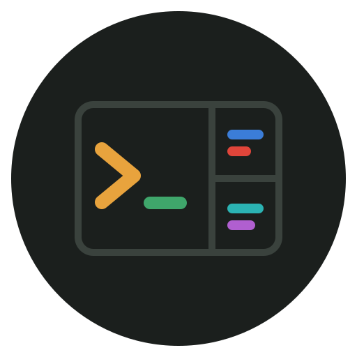
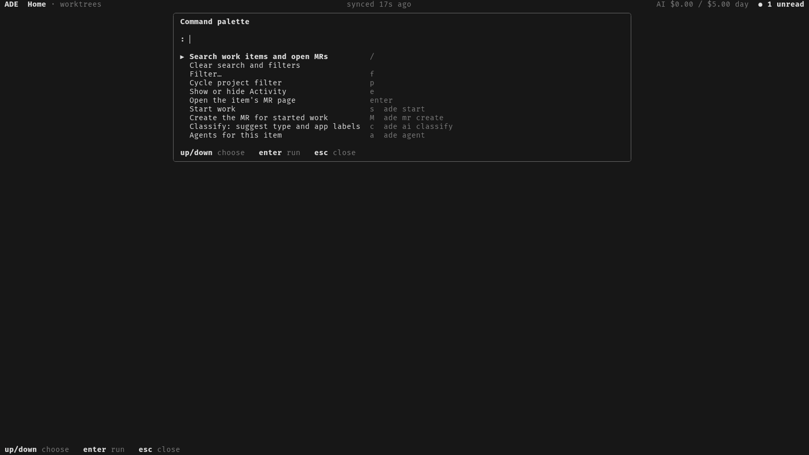

### ADE

[](https://github.com/coredev-uk/ade/releases)
[](https://github.com/coredev-uk/ade/releases)
[](https://github.com/coredev-uk/ade/actions/workflows/ci.yml)

An agentic development environment for the terminal: issues, merge requests, reviews, sprints, worktrees and agent runs in one dashboard.

[Download](https://github.com/coredev-uk/ade/releases) •
[Setup](docs/setup.md) •
[Reference](docs/reference.md) •
[Manifest](docs/manifest.md) •
[Release notes](CHANGELOG.md)

<br clear="left">



## Getting started

```sh
nix run github:coredev-uk/ade -- version      # try it
nix profile install github:coredev-uk/ade     # keep it
ade init && ade doctor && ade                 # configure, check, open the dashboard
```

No Nix? Static binaries for Linux and macOS are on the [releases page](https://github.com/coredev-uk/ade/releases).
The [setup guide](docs/setup.md) covers tools, tokens, self-hosted GitLab, Coder workspaces and an offline demo.

## Contributing

Report bugs and request features in [Issues](https://github.com/coredev-uk/ade/issues).
To change the code, read [Develop](docs/reference.md#develop); the spec is [docs/PLAN.md](docs/PLAN.md),
product constraints are in [PRODUCT.md](PRODUCT.md) and the visual system in [DESIGN.md](DESIGN.md).
