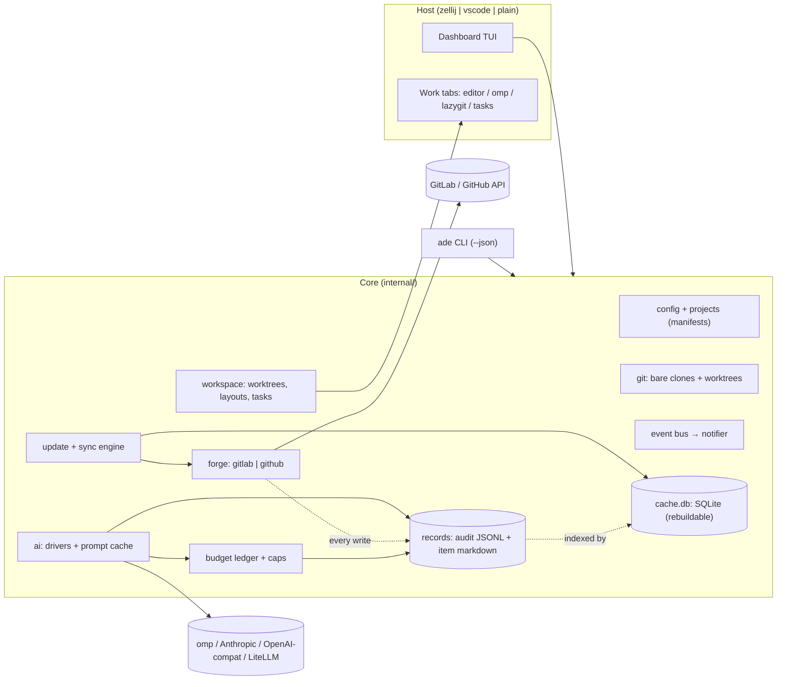
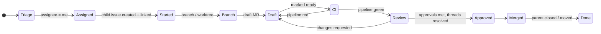

# ADE plan

Status: draft v1 · Owner: repo maintainer · Product truth: [PRODUCT.md](../PRODUCT.md)

All names in this document (`acme`, `tracker`, `api`, `web`, `jdoe`, `example.com`) are synthetic.

---

## 1. Shape of the thing

`ade` is one static Go binary with two faces:

- **CLI** (`ade <cmd> [--json]`): every capability is scriptable and usable from VS Code tasks.
- **Dashboard** (`ade` with no args): a Bubble Tea TUI running inside an ADE‑owned zellij session. Work items open as zellij tabs (editor, agent, lazygit, tasks).



**Process model.**

- The dashboard process owns the update/sync loop and the event bus.
- Other `ade` invocations (CLI calls, agent hooks inside panes) read and write the same SQLite cache (WAL mode, `modernc.org/sqlite`, no CGO).
- They append to the audit log under an exclusive file lock.
- Agent panes and task supervisors report status by writing run records. The dashboard watches the records directory with fsnotify and turns new records into events, so a task finishing in another pane still raises a notification. No daemon or socket is needed.
- Remote CDEs that auto‑stop lose nothing except the zellij session, and zellij session resurrection covers that.
- **Startup:** every start of `ade` runs a full update (2.3) in the background while the UI renders from cache.

---

## 2. Configuration (core function 4)

Two layers. Secrets never live in either file.

**One config per machine.** Work and personal use run on different machines. Each machine has its own user config: the work machine has the GitLab forge and the gateway AI profile, and the personal machine has GitHub and the Claude subscription. Manifests are shared through git. Records and the audit log stay on the machine that produced them and are never synced.

| Layer | Location | Shared? | Holds |
|---|---|---|---|
| User config | `~/.config/ade/config.toml` | never | identity, forges + credential *commands*, AI profiles, budgets, host/editor prefs, keymap |
| Project manifest | `*.ade.toml` (any repo or URL) | yes | tracker, repos, iteration source, conventions, tasks, workspaces |
| Local override | `*.local.toml` beside either file | never | per-machine paths, private extras (gitignored) |

```toml
# ~/.config/ade/config.toml
[user]
handle   = "jdoe"
timezone = "UTC"
workdays = ["mon", "tue", "wed", "thu", "fri"]

[forges.work]
kind      = "gitlab"
url       = "https://gitlab.example.com"
token_cmd = "pass show ade/gitlab"        # or token_env = "GITLAB_TOKEN"

[forges.personal]
kind      = "github"
token_cmd = "gh auth token"

[paths]
root = "~/ade"                 # <root>/<project>/<repo>/{.bare, main, <branch>…}  (2.2)

[[projects]]                   # one entry per project; the manifest defines its repos
source = "git+https://gitlab.example.com/acme/tracker.git#ade/acme.ade.toml"   # kept up to date by update
[[projects]]
source = "~/code/side-project/side.ade.toml"

[update]
on_start         = true
interval         = "10m"
feature_branches = "ff-if-clean"   # ff-if-clean | notify-only
concurrency      = 4

[notify]                       # event globs per channel (6.8)
toast    = ["*"]
terminal = ["ci.failed", "task.failed", "agent.run.end", "git.*.failed", "budget.stop"]
desktop  = []                  # notify-send, on machines that have a desktop
quiet    = "19:00-08:00"       # terminal/desktop channels silent; inbox still records

[ai]
mode    = "ask"            # off | ask | auto
profile = "claude-sub"

[ai.profiles.claude-sub]                       # personal machine
driver  = "omp"
billing = { source = "omp", weekly_soft_usd = 10 }   # no quota API: list-price usage vs a soft cap

[ai.profiles.gateway]                          # work machine
driver   = "openai-compat"
base_url = "https://llm.example.com/v1"
key_cmd  = "pass show ade/llm"
billing  = { source = "litellm" }              # cost headers + /key/info

[budget]
daily_usd        = 2.00
weekly_usd       = 8.00
confirm_over_usd = 0.25    # pre-flight confirmation threshold per action
agent_run_usd    = 1.50    # passed as --max-cost to omp runs

[host]
mode   = "auto"            # auto | zellij | vscode | plain
editor = "auto"            # auto: `code` inside VS Code terminal, else ade-nvim
glyphs = "unicode"         # unicode | nerd | ascii

[records]
dir               = "~/.local/share/ade"   # default: $XDG_DATA_HOME/ade
audit_retain      = "forever"              # or e.g. "365d"
snapshot_comments = 20                     # latest comments copied into item.md
```

```toml
# acme.ade.toml (shareable)
name  = "acme"
forge = "work"

[tracker]
project    = "acme/tracker"
board      = "Delivery"
iterations = { source = "gitlab-iterations", cadence = "Delivery" }   # cadence optional: pick one when the group has several
# other sources: auto | milestones | labels (pattern + cadence dates) | github-project | cadence
weight     = { source = "auto" }   # auto | gitlab (issue weight, Premium) | label (pattern = "weight::{value}") | github-field (field = "Estimate") | none

# Labels carry three independent facets. Patterns are per team; values come from the forge.
[labels.type]
pattern = "type::{value}"              # story | bug | … (display, filters)

[labels.app]
pattern = "app::{value}"               # value routes the issue to repos whose `app` lists it

[labels.workflow]
pattern = "workflow::{value}"          # the board column
stage   = { started = "in progress", draft = "in progress", review = "in review", merged = "done" }
sync    = "auto"                       # auto | ask | off: move the label when the derived stage changes

[repos.api]
path  = "acme/api"
app   = ["api"]                         # matches `app::api`

[repos.api.tasks.migrate]
cmd      = "make migrate"
kind     = "oneshot"                     # must exit 0 before dependents start
requires = ["services.db"]
env      = { DATABASE_URL = "postgres://localhost:{services.db.port}/acme" }

[repos.api.tasks.dev]
cmd      = "make run"
port     = "auto"                        # allocated per instance; or a fixed number
env      = { PORT = "{port}", DATABASE_URL = "postgres://localhost:{services.db.port}/acme" }
requires = ["api.migrate"]
ready    = { http = "http://localhost:{port}/healthz", timeout = "60s" }

[repos.api.tasks.test]
cmd      = "make test"
kind     = "oneshot"
requires = ["services.db"]

[repos.web]
path     = "acme/web"
app      = ["web"]
requires = ["api"]                       # checkout dependency: web work also gets an api tree

[repos.web.hooks]                        # run inside the tree; failures raise notifications
post_clone    = ["npm ci"]               # once, in main/ after `ade project add`
post_worktree = ["npm ci"]               # every new worktree (node_modules are per tree)

[repos.web.tasks.dev]
cmd      = "npm run dev -- --port {port}"
port     = "auto"
requires = ["api.dev"]                   # runtime dependency: api must be ready first
env      = { API_URL = "http://localhost:{api.dev.port}" }
ready    = { log = 'ready in \d+ ms', timeout = "90s" }

[services.db]                             # not a repo: shared infrastructure
cmd   = "postgres -D {state}/pg -p {port} -k {state}"
port  = "auto"
ready = { tcp = "localhost:{port}" }
keep  = true                             # survives when its last dependent stops

[conventions]
branch      = "{child_iid}-{slug}"
child_title = "{parent_title}"
child_body  = "templates/child.md"     # relative to manifest
link        = ["relates_to", "description"]   # always both: fixes today's inconsistency
child_issue = "auto"                     # auto | always | never (6.3)
mr          = { create = "ask", template = "Default", draft = true, closes = "child", mention = "parent" }   # create: ask | always | never

[groups]
dev = ["web.dev"]                       # pulls in api.dev → api.migrate → services.db

[workspaces]
default = { layout = "code",  run = "dev" }
agentic = { layout = "agent", run = "dev" }
```

`ade doctor` validates config, tokens and scopes, tools on PATH, and host capabilities. A JSON Schema generated from the Go structs gives editor completion (taplo / VS Code Even Better TOML).

### 2.1 Repo and task dependencies

A frontend that needs a running API is the normal case, not an edge case. ADE models it as two separate dependency graphs that it validates together.

**Checkout graph (`repos.<r>.requires`).** Opening a workspace for a repo also prepares a tree for every repo it requires, transitively. Tree resolution, per required repo:

1. **Same work item:** if the work item has its own child and branch in that repo, ADE uses that worktree. This is how a cross‑repo change gets web running against the *feature* API, not `main`.
2. **Explicit pin:** `ade work web#12 --with api=some-branch` (also selectable in the TUI before opening).
3. **Baseline:** otherwise the repo's `main/` worktree (2.2), kept current by the update loop (2.3).

**Run graph (`tasks.*.requires`, `services.*`).** Nodes are tasks (`<repo>.<task>`) and services (`services.<name>`). Edges are `requires`. Each node declares:

- **`kind`:** `service` (default; long‑running) or `oneshot` (must exit 0, e.g. migrations or codegen).
- **`ready`:** one of `http` (2xx), `tcp` (port open), `log` (regex on output), or exit 0 for oneshots, with a `timeout`.
- **`port`:** `auto` allocates a free port per instance; a fixed number is used as is.
- **`env`:** values can reference other nodes: `{port}`, `{dir}`, `{state}`, `{<repo>.dir}`, `{<repo>.<task>.port}`, `{services.<name>.port}`. This is how `API_URL` in web always points at the api instance actually serving this workspace.

**Instances and sharing.** A running instance is identified by (node, tree):

- Two workspaces that resolve to the same api tree share one api instance, reference‑counted. A workspace with its own api feature tree gets its own instance on its own port. Nothing collides, and nothing starts twice.
- When the last dependent stops, the instance stops, unless the node sets `keep = true` (typical for databases).
- Instances, ports, and PIDs are written to the item's run records (4.2) and shown in a **Services** strip on the workspace and Home preview: `db ● 54012 · api ● 54031 (feature tree) · web ◌ waiting on api`.

**Start order and failure.**

- Start order is a topological sort. Independent nodes start in parallel.
- A dependent starts only after all of its requirements are ready.
- If a requirement fails or times out, its dependents are not started. Each one shows `blocked: api.dev not ready (timeout 60s, last log line …)`. `r` restarts that subtree.
- Stopping a node stops its dependents first, in reverse order.

**Validation (load time and `ade config check`):**

- unknown references
- cycles, reported with the cycle path
- `env` templates that reference nodes outside the node's `requires` closure (so ordering can't be violated silently)
- fixed‑port clashes between nodes
- a `requires` on a repo in another loaded manifest must be qualified (`shared/auth.dev`); unqualified names resolve within the same manifest only

**Where else dependencies show up:**

- **Start work (6.3):** if the routed repo requires another, the confirm screen offers to also create a child issue there ("web requires api: create api child too?"). It is off by default.
- **Agents (6.6):** required repos' trees are passed with `--add-dir` (verified omp flag), so plans and runs can read the API contract while they write only the routed repo.
- **Merge order (3):** when one work item has open MRs in both repos and web requires api, the web MR shows `waits on api!N` until the api MR merges. Its court becomes `api!N` instead of `you`.
- **Hosts (6.7):** zellij gets one pane per instance, with requirements in a stacked "services" pane. VS Code gets generated `tasks.json` with `dependsOn`, `isBackground`, and a `background.endsPattern` for `log` readiness. For `http`/`tcp` readiness the generated task wraps the command in `ade task run --wait`. On the plain host, ADE supervises the processes itself.

### 2.2 Projects, clones, and worktrees

ADE manages several projects at once. Each project is one manifest, and each manifest lists any number of repos. Every repo is a bare clone plus git worktrees. Nothing is ever checked out in place.

```
~/ade/                                   paths.root
  acme/                                  project (manifest `name`)
    .project.toml                        resolved manifest snapshot + source + last update
    api/
      .bare/                             bare clone; fetch refspec set to refs/remotes/origin/*
      .git                               "gitdir: ./.bare", so git and lazygit work from api/
      main/                              baseline worktree on the default branch
      412-rate-limit-export/             one worktree per work-item branch
    web/
      .bare/  .git  main/  418-paginate-audit-log/
  side/
    …
```

- **`ade project add <source>`:**
  1. Fetch and validate the manifest (2.1 checks included).
  2. Create `<root>/<project>/`.
  3. Clone every repo in parallel (bounded by `update.concurrency`), with per‑repo progress.
  4. Add each `main/` worktree.
  5. Run `post_clone` hooks.

  It is idempotent: re‑running it fills in whatever is missing. A failure in one repo does not stop the others; each failure becomes a `git.clone.failed` notification. `ade project list|status|remove` complete the set. `remove` never deletes a worktree with uncommitted or unpushed work.
- **Bare‑clone pitfall (verified in a throwaway clone of the GitHub sandbox):** `git clone --bare` creates a local branch for every remote head, with no upstream and no remote‑tracking refs. So after cloning, ADE:
  1. sets `remote.origin.fetch` to `+refs/heads/*:refs/remotes/origin/*`
  2. fetches
  3. deletes the clone‑created local heads except the default branch

  New worktrees are then created with `git worktree add --track -b <branch> <dir> origin/<branch>`, or from `origin/<default>` for a new branch, so every worktree has a real upstream.
- **Worktree lifecycle:**
  - **Start work** creates the branch's worktree, then runs `post_worktree` hooks.
  - **Opening a workspace** reuses an existing worktree, never re‑creating it.
  - **When the MR merges**, a `mr.merged` notification offers to remove the worktree and local branch. Removal only happens if the tree is clean and fully pushed.
  - **`ade gc`** lists stale worktrees: merged, or branch gone on the remote.
  - The worktree path is what tabs, tasks, agents (`--cwd`), and editors receive.
- **Same repo in two projects:** each project gets its own bare clone. This is simple and isolated; disk usage is the cost.
- **Repos and lazygit:** lazygit opens in the worktree directory and works unchanged. The `.git` file at the repo root makes `<root>/<project>/<repo>/` usable for repo‑wide commands such as `git worktree list`.

### 2.3 Startup and periodic update

Every `ade` start (`update.on_start`), every `update.interval`, and on demand (`U` in the TUI, `ade update`), ADE runs the following. Repos update in parallel; the UI never blocks; progress shows in the header.

1. **Projects:** refetch each `[[projects]].source` (git or URL) and re‑validate. An invalid new manifest is rejected, the last good snapshot stays in use, and a `project.manifest.invalid` notification names the error.
2. **New repos** in a manifest are cloned (as in `project add`). Repos removed from a manifest are flagged in `ade project status`, never deleted.
3. **Fetch:** `git fetch --prune` in every bare clone.
4. **Baseline `main/`:** fast‑forward only, and only if the tree is clean. If it is dirty or has diverged, it is left untouched and a `git.pull.skipped` notification gives the reason.
5. **Feature worktrees:** with `ff-if-clean`, a tree that is clean and strictly behind its upstream is fast‑forwarded (for example, after an agent pushed from another tree, or a reviewer pushed a fix). Anything dirty, ahead, or diverged is never touched. It shows `↑2 ↓1` and raises a notification. ADE never merges, rebases, or stashes on its own. `notify-only` skips step 5's writes entirely.
6. **Forge sync:** issues, MRs, pipelines, and discussions (incremental), then derived stage and court.
7. **One summary event:** `git.update.done` ("pulled 6 repos · 1 skipped (web/main dirty) · 1 failed (api: auth)"). Each failure is its own `git.*.failed` event, with the git stderr in the inbox detail.

---

## 3. Domain model



- **WorkItem** = tracker issue + 0..n child issues + their MRs + pipelines + discussions. The stage is *derived* from forge data. ADE never stores it as truth.
- **Ball in court** is computed per item: `you` (unresolved threads addressed to you, red pipeline, requested changes), `reviewers`, `ci`, `nobody`. This is the scan column that answers "what do I touch next".
- **Merge order:** if a work item has open MRs in two repos and one repo `requires` the other (2.1), the dependent MR's court is the upstream MR (`waits on api!N`) until that merges.
- **Child linking:**
  - **GitLab** cannot make one issue the hierarchy child of another (only issue → task, same project). So ADE writes a cross‑project `relates_to` issue link (Free tier) *and* a description reference (`Parent: acme/tracker#128`).
  - **GitHub** supports real cross‑repo sub‑issues. This was verified on the sandbox, so ADE uses them plus the same description reference.
  - **Reading** accepts any of: link, sub‑issue/hierarchy, description reference, or MR/PR `Closes`/mentions, so inconsistent historical data still resolves. See [gitlab-api/README.md](gitlab-api/README.md).
- **Labels:** three facets, each described by a pattern in the manifest (2):
  - **type** (story, bug, …): shown as a glyph and word on every row, and used for filters.
  - **app**: the routing signal. Every `app` value on a tracker issue maps to the repos that list it. More than one value means a cross‑repo work item, and Start work offers a child in each.
  - **workflow**: the team's board column. ADE derives the stage from forge facts (child, branch, MR, CI, approvals) and, with `sync = "auto"` (the default), moves the label to match.
    - Every move removes the old workflow label explicitly, because `::` labels are not exclusive on Free (verified) and ADE can't rely on scoped‑label exclusivity. Each move is audited.
    - Moves are edge‑triggered: they happen only when the derived stage *changes*. A label someone sets by hand stays until the next transition, and meanwhile any contradiction shows as drift (`label: in review · MR still draft`). `ask` confirms each move; `off` only shows drift.
  - **Unmatched issues:** issues missing a type or app label appear in a "needs triage" filter. `c` (classify) suggests the missing labels, deterministically from title and description keywords, or with AI when it is enabled. Labels are applied only on confirm.
- **Epics:** teams differ, so nothing is assumed. Where tracker issues have a parent epic (GitLab group‑level epics, Premium), ADE shows the epic title on the row and preview, and can group sprint review by it. It reads the epic through the work‑item hierarchy widget and gates it by capability. ADE never creates or edits epics.
- **No team convention is hard‑coded.** Label patterns, workflow values, cadence choice, child‑link style, and branch naming all come from the manifest, because they vary between teams even inside one company.
- **Weights:** issues carry a weight (story points). Sources, chosen by `tracker.weight.source`:
  - GitLab's issue `weight` field (Premium; capability‑probed)
  - a label pattern (`weight::{value}`) for Free tiers
  - a GitHub Projects number field
  - `none`

  `auto` probes in that order. Weight appears on every row and preview, and it is copied to the child issue on Start work when the child's project supports it. Weight totals drive sprint load and sprint review (6.4).
  - **Missing weight:** a tracker issue without one counts as unweighted, never as 0, and joins the "needs triage" filter. `c` suggests a weight from similar closed issues of the same type and app; AI is used only when enabled, and nothing is applied without confirm.
  - **Read‑only:** ADE never re‑weights silently. Changing a weight is an explicit, audited action (`ade issue weight <ref> <n>`, or `=` in the TUI).
- **Iteration window:** show the current iteration. Within `overlap` (default 1 working day) of its end, also show the next. Within `overlap` of its start, also show the previous. Working days come from `user.workdays`. Iteration sources implement one interface: `Current(now)`, `Adjacent(n)`, `Issues(it)`.
  - **GitLab iterations (primary at work):**
    - Find them with `GET /groups/:id/iterations?state=current|upcoming|closed&include_ancestors=true`, narrowed to one cadence by `search=<cadence>&in=cadence_title` when configured.
    - List issues by `iteration_id`.
    - Iterations created by an automatic cadence have `title: null`, so ADE labels them `<cadence> · 3–14 Nov`.
    - Start work copies the parent's iteration to the child with GraphQL `issueSetIteration`, since REST has no iteration write.
  - Iterations are Premium, so they are tested against the fake server's premium mode and confirmed at work by `ade doctor --probe`. The Free sandbox exercises the same window logic through milestones.
  - Cadences can start on any weekday. GitLab's `due_date` is an iteration's last day, and the next iteration starts the following day. So the header reads `ends Mon 16 Nov · next starts Tue 17`, and "within 1 working day of the end" counts back from `due_date`. Tests cover cadences that start mid‑week, weekends inside an iteration, and 1/2/3/4‑week lengths.

---

## 4. Local records and audit

ADE keeps three stores. They are split by what losing each one costs.

| Store | Default path | Source of truth? | Losing it means |
|---|---|---|---|
| Audit log | `$XDG_DATA_HOME/ade/audit/YYYY-MM.jsonl` | yes, append-only | action history is gone; ADE never deletes it automatically |
| Item records | `$XDG_DATA_HOME/ade/items/<forge>/<project>/<iid>/` | yes for AI output, plans, runs, and notes; the snapshot part is regenerable | paid AI work has to be bought again |
| Cache | `$XDG_CACHE_HOME/ade/cache.db` | no | one full re-sync; `ade reindex` rebuilds indexes from the two stores above |

Why not SQLite alone: the DB is a cache that migrations and `ade cache reset` are allowed to drop. Anything that cost money or human time lives in plain files that survive schema changes. Those files can be grepped, opened in nvim or VS Code, and handed to an agent as `@path`.

Why not Markdown alone: dashboard queries (by stage, court, iteration, or spend per day) need indexes. SQLite indexes the files; it does not own them.

### 4.1 Audit log

One JSON line per action. The line is appended (under `flock`, then fsync) before the result is shown, and failures and cancellations are recorded too.

```json
{"id":"01JCQ8…","ts":"2026-11-11T09:15:02Z","actor":"user","action":"forge.issue.create",
 "target":"work:acme/api#412","item":"work:acme/tracker#128","params":{"title":"Rate-limit the export endpoint","labels":["svc::api"]},
 "dry_run":false,"outcome":"ok","url":"https://gitlab.example.com/acme/api/-/issues/412"}
{"id":"01JCQ9…","ts":"2026-11-11T09:16:40Z","actor":"user","action":"ai.summarize",
 "target":"work:acme/api!233","item":"work:acme/tracker#128","outcome":"ok",
 "ai":{"profile":"claude-sub","model":"<haiku-class id>","tokens":{"in":1840,"out":160},"cost_usd":0.0026,
       "cost_source":"reported","cache_hit":false,"artifact":"items/work/acme/tracker/128/ai/20261111T091640-summary-mr233.md"}}
```

- **Actors:** `user`, `ade:sync`, `agent:<run-id>`.
- **Actions:**
  - forge writes: `forge.*`, e.g. `issue.create`, `issue.link`, `mr.create`, `mr.merge`, `thread.reply`, `thread.resolve`, `approve`, `pipeline.retry`
  - AI calls: `ai.*`, cache hits included at $0
  - agent runs: `agent.run.start` / `agent.run.end`
  - `workspace.open`, `task.run`, `config.change`, `budget.override`
  - sync: one summary line per sync run (counts, errors). Individual reads are not logged.
- **Redaction:** tokens and auth headers are never written. Prompt bodies are never written to the audit log; they live in the AI artifact. `params` pass through a redactor that knows the configured credential values and common secret patterns.
- **One spend source:** the budget ledger is a query over the `ai` fields of audit events, indexed in `cache.db`. There is no second ledger to drift.
- **Retention:** kept forever by default (`records.audit_retain`). Monthly files are easy to archive.
- **Surfaces:**
  - `ade audit [--since 1d] [--item tracker#128] [--action 'forge.*'] [--json]` and `ade audit tail`
  - TUI **Log** page: filterable; `enter` jumps to the target
  - **History** tab on the work item page

### 4.2 Item records

There is one directory per work item, keyed by the tracker issue. Child issues, MRs, plans, and runs nest under it because the work item is the unit. Items without a tracker parent (for example, a review requested on someone else's MR) get their own directory keyed by their own ref.

```
items/work/acme/tracker/128/
  item.md                                   snapshot + your notes
  ai/20261111T091640-summary-mr233.md       one file per AI output
  ai/20261111T091902-classify.md
  plans/20261111T100215-plan.md             agent plans (reviewed/approved state in frontmatter)
  runs/01JCQB…/run.md                       agent run: model, cost cap, spend, exit, commits, transcript path
```

```markdown
---
ref: work:acme/tracker#128
children: [work:acme/api#412]
mrs: [work:acme/api!233]
stage: review
iteration: Sprint 42
synced: 2026-11-11T09:12:03Z
---
<!-- ade:snapshot:begin (regenerated on sync; edits inside are overwritten) -->
# Rate-limit the export endpoint
…description, labels, assignees, latest comments…
<!-- ade:snapshot:end -->

## Notes
Free-form. ADE never edits outside the snapshot block.
```

- **AI artifacts** carry frontmatter: `feature`, `profile`, `model`, `prompt_version`, `input_hash`, `tokens`, `cost_usd`, `created`, `audit_id`. The body is the output.
  - The AI result cache resolves `input_hash` → artifact through `cache.db`.
  - If `cache.db` is lost, `ade reindex` rebuilds the mapping from frontmatter, so nothing is paid for twice.
- **Notes feed context.** Plan and draft actions can include the item's `## Notes` (shown in the pre-flight prompt preview, toggle per call).
- **Offline:** the work item page renders from `item.md` and its artifacts when the forge is unreachable or the cache is empty.
- **`ade item <ref>`** prints the record path, and `ade item <ref> --edit` opens `item.md` in the configured editor. In the TUI, `n` opens notes.
- **Privacy:** these directories hold real work data, and they live outside every repository. `ade doctor` warns if `records.dir` resolves inside a git work tree. On remote CDEs, point `records.dir` at the persistent home volume.

### 4.3 Data handling

There is no per‑project sensitivity policy. Work runs inside closed environments, and AI goes wherever that machine's profiles point (decided 2026‑11‑11). These cheap protections stay:

- AI audit events record `dest_host` and `bytes`, so "what left this machine" is always answerable.
- Agent runs get `--session-dir <item record>/runs/<id>`, so transcripts land in the records store, not the agent's global history. Explain calls use `--no-session`.
- ADE has no telemetry. `--debug-http` logs method, path, status, and timing, never bodies. ADE never starts `zellij web`.

## 5. Forge layer

```go
type Forge interface {
    Me(ctx) (User, error)
    Capabilities(ctx) (Caps, error)                     // probed per feature, cached 24h; never inferred from tier
    AssignedIssues(ctx, scope) ([]Issue, error)        // incremental via updated_after
    Issue(ctx, ref) (IssueDetail, error)
    LinkedIssues(ctx, ref) ([]IssueLink, error)
    CreateIssue(ctx, project, IssueDraft) (Issue, error)
    LinkIssues(ctx, a, b, kind) error
    MergeRequestsFor(ctx, issueRef) ([]MR, error)
    MR(ctx, ref) (MRDetail, error)                       // pipeline, approvals, diffs meta
    Discussions(ctx, mrRef) ([]Thread, error)
    Reply(ctx, thread, body) / Resolve(ctx, thread, bool) / Approve / Merge / CreateMR / CreateBranch
    Iterations(ctx, src IterationSource) ([]Iteration, error)
    Events(ctx, user, since) ([]Event, error)            // standup + sprint review
}
```

- **GitLab first** via `gitlab.com/gitlab-org/api/client-go`. REST covers issues, links, MRs, discussions, approvals, pipelines, events, milestones, and *reading* iterations. GraphQL covers assigning iterations, iteration cadences, draft toggling, and the work‑item hierarchy (all GraphQL‑only per the docs).
- **Contract is docs-first:** no paid instance is available for development. Every endpoint, field, tier gate, and test strategy is pinned in [docs/gitlab-api/](gitlab-api/README.md), with source URLs.
  - Doc‑derived fixtures, split `free/` and `premium/`.
  - A fake GitLab with a tier switch.
  - GraphQL queries validated against GitLab.com's committed public schema.
  - An optional Free sandbox (`-tags live`).
  - `ade doctor --probe`: a read‑only *shape* check against real instances that reports field and status mismatches, never values.
- **Capabilities, not tiers:** each gated feature (iterations, cadences, approval rules, `blocks` links, scoped labels, epics) is probed and cached. The UI degrades per capability: "approved by 2" instead of "2 of 3 required", milestones instead of iterations.
- **GitHub second** via `google/go-github` + `shurcooL/githubv4` (Projects v2 iteration fields, sub‑issues via `POST /repos/{o}/{r}/issues/{n}/sub_issues`, review threads).
- **Rate limits:** honour `RateLimit-*` headers when present and `Retry-After` on 429, with at most 4 concurrent requests per host. Incremental sync uses `updated_after`, because ETags are undocumented for `/api/v4`. Sync status is shown in the header, never as a modal.
- **Activity:** user events omit MR events, so standup and review data combine user events, MR lists (`updated_after`, author/reviewer), and project events.
- **Fixtures** are synthetic and doc‑derived. No captured real traffic is ever committed.

---

## 6. Surfaces (TUI) — mode: Operate

Design is settled per the impeccable flow. Before any screen is built, Phase 0 runs the visual‑world round (new‑work, Operate mode) and writes `DESIGN.md`: ANSI colour roles, glyph set and fallbacks, density, focus treatment, light/dark behaviour. The wireframes below fix **structure and behaviour only**.

Global conventions: `j/k` move, `enter` open, `esc` back, `tab` switch pane, `/` filter, `:` command palette, `?` keymap overlay, `r` refresh, `o` open in browser, `y` copy (OSC 52, so it works in VS Code and browser terminals). Breakpoints: ≥140 cols three regions, 100–139 two, <100 one with a toggled preview. Never colour‑only state.

### 6.1 Home (core functions 1, 6)

```
 acme · Sprint 42 · 2 workdays left · next: Sprint 43     ⟳ updating 4/7   synced 40s   AI $0.38 / $2.00   ● 3
 ─ My work ─────────────────────────────────────────────── │ ─ tracker#128 ──────────────────────────
  STAGE      ITEM                                COURT     │ Rate-limit the export endpoint
 ▸ Review    #128 Rate-limit export endpoint     you  2💬  │ api#412 · !233 draft→ready · CI ✓
   CI        #131 Paginate audit log             ci   ⟳    │ Approvals 1/2 · 2 unresolved threads
   Started   #140 Retry webhook deliveries       you       │
   Assigned  #144 Remove legacy CSV path         you       │ Summary (AI · cached)
 ─ Reviews requested ───────────────────────────────────── │  Adds token-bucket limiter per tenant;
   !240  web  Dark-mode tokens            jkim  4 files    │  open question on burst size.
 ─ Sprint 42 · open (12) ─────────────── Sprint 43 (5) ─── │ Threads
   #150 Billing export timeouts    unassigned   P2         │  ● burst=50 too high?  — reviewer
   …                                                       │  ● missing test for 429 — reviewer
 enter open · s start · w workspace · a agent · ? keys
```

- Sections: **My work** (assigned, sorted by court then stage), **Reviews requested**, **Iteration** (current plus adjacent per the window rule), **Activity** (collapsed). With several projects, the view merges them; every row is prefixed by its project, and `p` filters to one project.
- Each row shows a progress track (stage glyph sequence) with the court, open thread count, pipeline state, and weight (`3w`; `–` when unweighted). Progress also folds in task‑list completion from the issue body. Section rules carry load in their guide words: `Sprint 42 · 21w committed · 8w done · 13w left`.
- The preview region shows the selected item. `enter` opens the full Work Item / MR page. Both modes exist, as requested.
- Actions: `s` start work (6.3), `w` open workspace, `a` agent menu, `c` classify (suggest missing type/app labels), `n` notes, `i` inbox (6.8), `U` update now, `S` standup, `L` log. `f` filters by type, app, workflow, or "needs triage".

### 6.2 Work item / MR page (core function 2)

```
 ← Home  tracker#128 › api#412 › !233  Rate-limit export endpoint    [Overview] Threads  Diff  CI  History
 ─────────────────────────────────────────────────────────────────────────────────────────────────────
  Draft → Ready · CI ✓ 6m · Approvals 1/2 (needs: backend-owners) · mergeable after threads resolved
  Summary  (AI · haiku · $0.002 · cached until description changes)            [d] raw description
   ...
  Unresolved (2)                                     Resolved (5) ▸
   ▸ src/limit.go:42   "burst=50 too high?"  jkim · 2h    [R]eply  [x] resolve  [A] AI draft reply
```

- Tabs:
  - **Overview:** status strip, AI summary ⇄ raw description, linked parent/child
  - **Threads:** unresolved first, grouped by file, with diff context
  - **Diff:** file tree + chroma‑highlighted hunks; `D` opens `delta` in a pane
  - **CI:** jobs, failing job log tail, retry
  - **History:** this item's audit events interleaved with its AI artifacts, plans, and runs (4.1, 4.2)
- Actions: reply, resolve, approve, mark ready, merge (with an explicit confirm), retry pipeline. AI actions: summarise MR, summarise thread, draft reply, "address comments" (hands off to agent, 6.6).
- The body editor is `$EDITOR` in a zellij floating pane (or a VS Code tab), so long replies never get typed into a cramped text field.

### 6.3 Start work (tracker‑project pattern)

```mermaid
sequenceDiagram
  participant U as User
  participant A as ADE
  participant F as Forge
  participant G as git / host
  U->>A: s on tracker#128
  A->>A: route by app labels → repos (classify if labels missing)
  A-->>U: preview: child issue, link, branch, draft MR, worktree, tab
  U->>A: confirm (edit any field)
  A->>F: create child issue in acme/api (assignee, type label copied; iteration via GraphQL issueSetIteration)
  A->>F: move tracker workflow label → "in progress" (if labels.workflow.sync)
  A->>F: relates_to link + "Parent:" reference
  A->>F: create branch 412-rate-limit-export + draft MR (Closes #412, mentions parent)
  A->>G: fetch, worktree add --track ~/ade/acme/api/412-rate-limit-export, post_worktree hooks
  A->>G: open workspace tab (layout from manifest)
```

One confirm screen shows every write before it happens. It is idempotent: re‑running detects an existing child, branch, or MR and resumes from the next missing step.

**The Start work dialog is a short flow, not a single yes/no:**

1. **Project and repos:** app labels pre‑select the repos. The user can change the selection or pick several for a cross‑repo item. The tracker issue's own project can also be picked when the work lives there.
2. **Child issue:** on when the tracker project differs from the chosen repo, off when the issue already lives in the code repo. Default from `conventions.child_issue = auto | always | never`. When there is no child, the branch and MR reference the tracker issue directly.
3. **What to create.** Default from `conventions.mr.create = ask | always | never`; changeable per issue in the dialog:

   | Mode | Forge writes | Local |
   |---|---|---|
   | **Draft MR** | child, link, branch, draft MR | worktree on the branch |
   | **Branch only** | child, link, branch | worktree on the branch; `M` creates the MR later, from the same template |
   | **Browse** | none | worktree on the default branch (or an existing branch) to read the code; nothing is assigned or announced |

4. **MR template:**
   - ADE reads the repo's template from the baseline tree: `.gitlab/merge_request_templates/Default.md` (or a chooser when there are several), and on GitHub `.github/pull_request_template.md`.
   - It fills the `Closes`/parent references and shows the rendered body for editing before anything is sent.
   - Quick actions in the template (`/assign`, `/assign_reviewer`, `/label`, …) run on the forge the moment the MR is created, which is how templates end up auto‑assigning everyone. The dialog lists them explicitly ("this template will request review from @a @b @c"), and each can be kept or stripped. Stripping them only affects this MR.
5. **Confirm:** the station list of writes (as in the preview), then `enter`.

### 6.4 Agile (core function 5)

- **Standup:** *Yesterday* is the previous working day (weekend and holiday aware).
  - Evidence comes from forge events (MRs opened, merged, and reviewed, comments, issue transitions, pushes) plus the local audit log (agent runs, plans, workspaces opened). The audit log catches work that never reached the forge.
  - *Today* covers in‑progress items ordered by court and stage, then the next items by priority in the current iteration.
  - *Blockers* are red pipelines, threads waiting on others for more than 1 day, and blocked labels.
  - Without AI it is a deterministic bullet list. With AI the same facts become a 4–6 line spoken‑style summary, saved as an artifact under `items/_standup/`.
  - `y` copies it; `ade standup --json|--md` works too.
- **Sprint review:** for the iteration window it shows done vs carried over, by count *and* by weight (committed, done, and carried weight, plus scope added mid‑sprint in weight), velocity across the last N iterations in weight, merged MRs grouped by parent, cycle time per item (assigned → merged), and a burn‑down by remaining weight from close events (by count when the team doesn't weight). The optional AI narrative per parent goes into a markdown export.
- **Sprint load:** the iteration header shows your assigned weight against your recent per‑sprint average, so over‑commitment is visible at planning time. It is informational, never a block.

### 6.5 Budget (core function 3)

- **Ledger:** derived from `ai` audit events (4.1). Each entry holds the timestamp, feature, profile, driver, model, tokens (in/out/cache), cost, cost source (`reported` | `computed` | `gateway`), cache hit, and item ref.
- **Billing sources:** each profile names a `billing.source`. Endpoints, auth, and gaps are pinned in [docs/billing/](billing/README.md).

| Source | Authoritative call | Key needed | Gives | ADE computes |
|---|---|---|---|---|
| `litellm` | per request: `x-litellm-response-cost`, `x-litellm-key-spend`; poll `GET /key/info` every 60 s, falling back to `/team/info` / `/user/info` when the key has no `max_budget` | the user's own virtual key | spend, `max_budget`, `budget_duration`, `budget_reset_at`, `soft_budget` | remaining, burn rate, time to reset; stream cost from the final `usage` chunk; pre‑flight prices from `/model_group/info` |
| `anthropic` | `GET /v1/organizations/analytics/cost` (beta header), reconciled daily | Admin key (optional) | org cost, 4–24 h lag | per‑request cost from usage × prices (primary) |
| `openai` | `GET /v1/organization/costs`, reconciled daily | Admin key (optional) | daily cost buckets | per‑request cost from usage × prices (primary) |
| `moonshot` | `GET /v1/users/me/balance` every 5 min | normal key | available, voucher, and cash balance (USD) | spend since the last snapshot |
| `openrouter` | `GET /api/v1/key` every 60 s | normal key | usage, `limit_remaining` | — |
| `omp` (subscription) | none documented | — | per‑turn `usage.cost.total` (list‑price equivalent, verified) | usage vs `weekly_soft_usd` |

- **Merge rule:** displayed spend = last authoritative snapshot + local ledger since that snapshot's `as_of`.
  - Provider stop errors are the hard backstop and become `budget.stop` audit events. Classify them by body, not status: LiteLLM returns `budget_exceeded` / "Budget has been exceeded" with a status that varies by version, and Anthropic returns `enforced_spend_limit_reached`.
  - The undocumented Claude subscription quota endpoint is not used.
- **Controls:** daily, weekly, and per‑sprint caps are enforced locally against the merged figure, next to the provider's own cap ("gateway $31.20 of $50 · resets 1 Dec"). Each action gets a pre‑flight estimate, with a confirm above `confirm_over_usd`. Agent runs get a hard cap (`--max-cost`). `ai.mode=off` gives a global kill switch.
- **Spend avoidance:** results are cached by `hash(prompt version, model, input content)`, and the cache is backed by durable artifacts (4.2). Unchanged issues and threads are never re‑summarised, even after a cache reset. Prompts are trimmed (thread diffs clipped, quoted replies collapsed). Explain calls use a minimal system prompt and no tools: omp's default prompt alone costs ~2.2k input tokens per call (observed), so ADE passes `--system-prompt` and `--no-tools`.
- **Page:** spend by day, feature, and model; remaining headroom; top costly items; the active profile with per‑role models.

**Profiles.** Roles map to model *classes*; concrete IDs are resolved at config time (`ade ai models` lists what the driver or gateway exposes). A `review` role (6.9) defaults to the `draft` model; it is worth setting separately where a stronger model catches more for little extra cost.

| Profile | Driver | explain (summaries, classify, standup) | draft (replies, MR text) | plan | implement |
|---|---|---|---|---|---|
| claude-sub | omp (subscription) | Haiku‑class | Sonnet‑class | Opus‑class | Sonnet‑class |
| claude-api | anthropic | Haiku‑class | Sonnet‑class | Opus‑class | Sonnet‑class |
| openai | openai‑compat | mini‑class | flagship | reasoning‑high | codex‑class |
| kimi | openai‑compat (Moonshot) | K2‑class | K2‑class | K2 thinking | K2‑class |
| gateway‑mix | openai‑compat → LiteLLM | cheapest of mix | Sonnet‑class | best reasoning in mix | per‑team choice |

### 6.6 Agents and workspaces (core function 7)

- **Layouts** are generated zellij KDL (`--layout-string`), one tab per work item:
  - `code`: editor 60% | lazygit + shell stacked
  - `agent`: omp 60% | lazygit + tasks
  - `review`: diff/threads + delta
  - `manual`: no agent pane
- **Tasks** come from the run graph (2.1). `w` opens a workspace, and its `run` group starts in dependency order. Requirements land in a stacked services pane, and the workspace's own tasks get regular panes.
- **Plan:** ADE gathers the parent issue, child issue, comments, notes, and repo `AGENTS.md`, then starts omp in plan mode in the worktree with a seeded prompt file. The plan is saved to the item record (`plans/`, 4.2), never into the worktree, and reviewed in the TUI.
- **Run:** omp executes the approved plan with `--max-cost` and the implement‑role model. `runs/<id>/run.md` tracks state, spend, exit, and resulting commits, and every run brackets with `agent.run.start/end` audit events. lazygit opens beside the run for review. "Address comments" uses the same path, seeded with unresolved threads.
- **Agent CLI drivers:** `omp`, `claude`, and `codex` are discovered on PATH and chosen per profile.

### 6.7 Hosts and editors

| Host | Detection | Workspace | Tasks | Editor |
|---|---|---|---|---|
| zellij | default; `$ZELLIJ` set or zellij on PATH | tabs/panes via `zellij action` | panes | ade-nvim / `$EDITOR` |
| vscode | `$TERM_PROGRAM=vscode` and no zellij, or `host.mode=vscode` | `code <worktree>` new window | exported `.vscode/tasks.json` (`dependsOn`, background readiness) | `code -g file:line` |
| plain | fallback | TUI only, `cd` hints | ADE‑supervised processes in dependency order, with a log viewer | `$EDITOR` |

VS Code specifics:

- zellij inside the VS Code terminal uses ADE's shipped config with the non‑colliding "unlock‑first" keybinding preset.
- ADE emits a recommended `terminal.integrated.commandsToSkipShell` snippet via `ade doctor --vscode`.
- `editor=auto` opens files in the surrounding VS Code window even from a zellij pane.
- Browser terminals get the same zellij session.

**ade-nvim** (Phase 3): a Nix‑wrapped Neovim (`nix run .#ade-nvim`) with `NVIM_APPNAME=ade-nvim`, so it never touches an existing config. Plugins are pinned from nixpkgs with no runtime downloads: mini.nvim (pick, files, diff, git, clue, statusline, completion), nvim‑treesitter with prebuilt grammars, and nvim‑lspconfig with native `vim.lsp`. Language servers come from each project's devshell. The target is a fast startup and a keymap that mirrors the ADE keys.

### 6.8 Notifications

Every subsystem publishes typed events onto one in‑process bus: update/sync, git, task runner, agent runs, forge diffs, and budget. Events from other `ade` processes arrive through run records and the audit log (1). The notifier applies the `[notify]` rules and delivers to channels.

| Event (examples) | Source |
|---|---|
| `git.update.done`, `git.pull.ok`, `git.pull.skipped`, `git.pull.failed`, `git.clone.failed` | update loop (2.3) |
| `task.ready`, `task.done`, `task.failed`, `task.blocked` | run graph (2.1) |
| `ci.passed`, `ci.failed`, `ci.canceled` | pipeline status change on your MRs |
| `mr.comment`, `mr.approved`, `mr.changes_requested`, `mr.merged`, `mr.review_requested` | forge diff between syncs |
| `issue.assigned`, `issue.iteration_changed` | forge diff |
| `agent.run.end`, `agent.run.failed`, `agent.plan.ready` | agent runs (6.6) |
| `budget.warn` (80 %), `budget.stop`, `project.manifest.invalid`, `worktree.removable` | budget, projects, worktrees |

Channels:

- **Inbox (always on):**
  - Every notification is stored in `cache.db` with read/unread state. Losing the cache loses only read state, because history stays in the audit log and run records.
  - `i` opens it, and the header shows the unread count (`● 3`).
  - `enter` jumps to the subject: the MR, failing job log, task pane, agent run, or worktree. Bulk mark‑read and per‑event mute are available.
  - `ade inbox [--unread] [--json]` gives the CLI view.
- **Toast:** a transient line in the TUI footer, lasting 5 s, or until dismissed for failures. Failures stack and stay until acknowledged.
- **Terminal:** best effort.
  - It writes one OSC 9 notification (`title: body`) through the renderer.
  - Verified with zellij 0.45: a pane's OSC 9 passes through unchanged, OSC 777 is rewritten to OSC 9, and BEL is dropped. So ADE sends only OSC 9 and never doubles up.
  - Whether the outer terminal shows it depends on the terminal: iTerm2, WezTerm, Ghostty, and Windows Terminal do. VS Code's integrated terminal is still to be checked by hand.
  - In zellij it also prefixes the affected work item's tab name with `●` until the item is viewed.
- **Desktop:** `notify-send` where a desktop session exists. Off by default, so it never runs on remote CDEs.

Quiet hours mute the terminal and desktop channels; the inbox still records everything. Forge‑derived events are computed by diffing consecutive syncs, so they work on every tier with no webhooks. Events caused by your own actions in ADE (for example, you approving) are not echoed back to you.

### 6.9 Review

One review surface serves both modes: reviewing yourself and triaging an agent's draft.

- **Pick an MR/PR:**
  - from **Reviews requested** on Home
  - from `/` search across every project's open MRs
  - by `ade review <ref>`, which opens the MR in a review workspace tab (`review` layout: diff + threads, with `delta` beside it)
- **Write comments:** `c` on a diff line opens a small comment dialog. Comments collect as drafts and nothing is posted yet.
- **Ask an agent:**
  - `A` runs a review pass with the profile's `review` role. The input is the diff, the linked issue, its acceptance list, the repo's `AGENTS.md`/contributing notes, and existing threads, so the agent doesn't repeat what reviewers already said.
  - The output is structured: each comment has a file, a line and side, a severity (`blocking`, `suggestion`, `question`, `nit`), a body, and an optional suggested change.
  - It is saved as an AI artifact in the item record (4.2), with a pre‑flight cost estimate as usual.
- **Keep comments short:** the review prompt enforces the house style:
  - one point per comment
  - lead with the problem, then the fix
  - at most two sentences plus an optional suggestion block
  - no praise or restating the code
  - nits are batched into one comment

  Drafts longer than 280 characters are flagged `long` in the triage list so they get trimmed before posting.
- **Triage the agent's drafts** inline on the diff, one at a time or from a list:
  - `y` accept
  - `e` edit (inline, or `$EDITOR` for long ones)
  - `n` deny, with an optional one‑word reason
  - `Y` accept all remaining

  Severity can be changed while triaging. Every decision is audited (`review.comment.accept|edit|deny`). Accept, edit, and deny rates per profile show on the budget page, so a noisy reviewer model is visible.
- **Submit once:** every accepted comment goes out as a single batch, so the author gets one notification, not twenty.
  - **GitLab:** draft notes (Free tier), then bulk publish. Diff positions come from the MR's latest version SHAs.
  - **GitHub:** a pending review with comments, submitted as `COMMENT`, `REQUEST_CHANGES`, or `APPROVE`.

  An optional overall summary is drafted too and edited like any comment. Approving stays a separate, explicit key.
- **Agent‑free:** with `ai.mode = off` the same surface works for manual review. Only `A` disappears.

---

## 7. Code layout

```
cmd/ade/                 cobra root; `ade` → host launch, subcommands
internal/config/         schema, load/merge/override, manifest fetch, JSON Schema gen
internal/store/          cache.db (modernc SQLite), migrations, queries, reindex from records
internal/audit/          append-only JSONL writer (flock), redactor, query
internal/records/        item dirs, item.md snapshot/notes merge, AI artifacts, plans, runs
internal/forge/          interface, Caps; gitlab/ (REST + GraphQL, fake/ with tier switch, testdata/{free,premium}, schema.graphql), github/
internal/domain/         WorkItem, stage + court derivation, iteration window
internal/project/        project registry, manifest fetch/validate/snapshot, `project add|list|status|remove`
internal/git/            bare clone + refspec fix, worktrees (add/track/remove/gc), fetch, ff-only, ahead/behind, hooks
internal/sync/           update loop (2.3), incremental forge sync, forge diff → events
internal/events/         typed event bus; run-record/audit watchers for cross-process events
internal/notify/         rules, inbox store, toast/terminal/desktop channels
internal/ai/             drivers (omp, anthropic, openaicompat), prompts/ (versioned), result cache
internal/budget/         ledger view over audit, prices, caps, estimates, gateway spend
internal/agile/          standup, sprint review
internal/workspace/      worktrees + tree resolution, run graph (validate, toposort, readiness, instances, ports), layouts (KDL), vscode export
internal/host/           zellij, vscode, plain
internal/tui/            app shell, router, keymap, theme (from DESIGN.md); pages/, components/
nix/                     ade-nvim, zellij config
docs/                    PLAN.md, config reference
```

Verification:

- Unit tests on domain derivation (stage, court, iteration window edge cases around weekends and overlap).
- `teatest` golden tests for pages at 80×24, 120×40, and 200×50, in dark, light, and NO_COLOR.
- VHS tapes produce screenshots for design review.
- `nix flake check` runs lint and tests.

---

## 8. Phases

| # | Phase | Delivers | Acceptance |
|---|---|---|---|
| 0 | Foundations | flake (done), Go module, cobra skeleton, config load + `ade doctor`, audit writer + `ade audit`, projects (`ade project add/list/status`), bare clone + worktree layout (2.2), startup/periodic update (2.3), event bus + inbox/toast/terminal notifications (6.8), zellij launcher (`ade` attaches/creates session `ade`), **visual‑world round → DESIGN.md**, Phase‑0 Home (projects → repos → worktrees, update progress, inbox drawer, toasts) in the Interchange direction | `ade project add` on the GitHub and GitLab sandbox manifests clones every repo into `<root>/<project>/<repo>/{.bare,main}`, and every worktree has an upstream. Re‑running it is a no‑op. Starting `ade` fetches all repos and fast‑forwards clean `main/` trees. A dirty `main/` is skipped with a notification. A deliberately broken remote raises `git.fetch.failed` in the inbox while the other repos still update. OSC behaviour through zellij is checked and recorded (done: OSC 9 only). A no‑op update toasts but adds no inbox row. Every command leaves an audit line |
| 1 | Read‑only home | GitLab forge (issues, links, MRs, pipelines, milestones, iterations read), capability probe + `ade doctor --probe`, fake GitLab (free/premium), committed GraphQL schema + query validation, sync + cache, item records (`item.md` snapshots), iteration sources (GitLab iterations with cadence filter and null‑title naming; milestones, labels, cadence), weight sources (GitLab weight, label, none) + row/section weight display, label facets (type/app/workflow) + drift display, stage/court derivation, Home page + preview | Fake‑server tests pass in both tier modes, including the iteration window over current/upcoming/closed iterations from one named cadence, and weights read from the Premium `weight` field; every GraphQL document validates against the schema; on the GitLab sandbox (`scripts/sandbox/gitlab-seed.sh`), assigned tracker issues show correct child, MR, stage, court, type, app, label‑based weight (unweighted shown as `–`, not 0), workflow drift, and a milestone‑based iteration window with weight totals; navigation never waits on network; notes below the snapshot survive re‑sync |
| 2 | MR page + manual review | threads, diff, CI tabs; reply, resolve, approve, ready, merge, retry; review surface (6.9) with line comments, draft batching, and single submit (GitLab draft notes + bulk publish, GitHub pending review) | Full review round‑trip on a sandbox MR without the web UI; five line comments arrive as one batch (one notification); a comment on a renamed file lands on the right line |
| 3 | Start work + workspaces | Start‑work flow (6.3): repo picker with app‑label preselection, child issue auto/always/never, Draft MR / Branch only / Browse modes, MR template read from the baseline tree with quick actions listed and strippable, `M` to create the MR later; iteration copy via `issueSetIteration`, workflow label sync, checkout + run dependency graphs (2.1), baseline trees, port allocation, readiness probes, shared instances, layouts, VS Code host + tasks.json export, ade-nvim; sandbox `api` gains a tiny HTTP server with `/healthz` and `web` a dev server that calls `API_URL` | `s` on a tracker issue yields linked child + draft MR + worktree + tab; re‑run is idempotent; Branch only creates no MR and `M` later creates it from the template; Browse makes no forge write at all (audit shows none); a template containing `/assign_reviewer` lists the reviewers and, when stripped, the created MR has no reviewers; an issue with two app labels offers a child in each repo; with `sync = auto` the tracker's workflow label moves to "in progress" and the old one is removed. Opening a `web` workspace starts db → api (ready on `/healthz`) → web, with `API_URL` pointing at the right port. A second web workspace reuses the same baseline api instance. A work item with its own api branch gets its own api on a different port. Killing api leaves web marked `blocked`. Cycles are rejected with the path. The same flow works in VS Code via tasks.json without zellij |
| 4 | AI explain + budget + agent review | drivers (omp, anthropic, openai‑compat), billing sources (litellm, omp first; anthropic, openai, moonshot, openrouter), AI artifacts + result cache, ledger over audit, caps, pre‑flight, budget page, Log page + History tab, profiles (incl. `review` role), summaries/classify/draft reply, agent review drafts with accept/edit/deny triage (6.9) | Second summary of an unchanged MR costs $0 (cache hit), also after deleting `cache.db` and running `ade reindex`; against a local LiteLLM proxy (`nix develop .#gateway`) with a budgeted virtual key, the budget page matches `/key/info` and an over‑budget call is classified as `budget.stop`; agent review on a sandbox MR yields structured comments, denied ones are never posted, edited ones post as edited, all accepted ones arrive as one batch; cap breach blocks with a clear message; `ai.mode=off` hides nothing essential |
| 5 | Agile | standup, sprint review (deterministic + AI narrative) with weight‑based committed/done/carried, velocity, and burn‑down, sprint load in the header, exports, OSC 52 copy | Standup over a Monday correctly uses Friday; review totals (count and weight) match forge data on the sandbox; an unweighted issue never contributes 0 to velocity |
| 6 | Agents | plan/run/address‑comments via omp (claude/codex drivers), session dir in item record, run tracking, cost caps, lazygit integration | Plan → approve → run → review → push completes on a sandbox issue within `agent_run_usd`; the transcript lands only in the item record |
| 7 | GitHub + team | GitHub forge parity (sub‑issues as the child link), `ade init` onboarding, shared manifest docs, release (goreleaser + flake package) | Same Home/MR/Start flows on the GitHub sandbox (`scripts/sandbox/github-seed.sh`); a teammate goes from zero to dashboard via `ade init` |

---

## 9. Risks and open decisions

- **No paid GitLab instance during development.** Premium paths (iterations, cadences, approval rules, `blocks` links) are built from the docs and the fake server alone, and confirmed later by `ade doctor --probe` (read‑only, shape‑only) on a real instance. Free‑tier behaviour is verified on the sandbox. Remaining gaps are listed in [gitlab-api/README.md](gitlab-api/README.md#open-questions-need-a-paid-instance).
- **Subscription quota is not observable.** omp reports list‑price usage only, so subscription budgets are soft caps on that figure until a quota endpoint exists.
- **VS Code key capture.** Some chords never reach the terminal. The keymap avoids Ctrl+Shift chords and documents `commandsToSkipShell`.
- **Data egress** is governed only by which AI profiles each machine has configured. There is no per‑project policy, by decision; see 4.3.
- **Local records** hold real work content in plain files. They stay outside repos, are created `0700`, and are never synced between machines. Backups are the user's call.
- **Writes are irreversible‑ish.** Every forge write goes through a preview/confirm, and `--dry-run` is available on every write command.
- **Terminal notification support is uneven.** zellij passes OSC 9 (verified), but terminals differ in whether they show it, and VS Code's integrated terminal is unverified. The inbox and toasts are the guaranteed channels, and the terminal channel is an extra.
- **Disk use:** a bare clone per repo per project, plus per‑worktree dependencies (`node_modules`). `ade gc` and merged‑worktree prompts keep it bounded.
- Open: diff rendering inside the TUI vs always delegating to delta (decide after the Phase 2 spike); whether run tracking needs a socket once agents run in parallel; whether services should optionally run via `docker compose` / `process-compose` instead of plain commands (the run graph stays the same either way).
