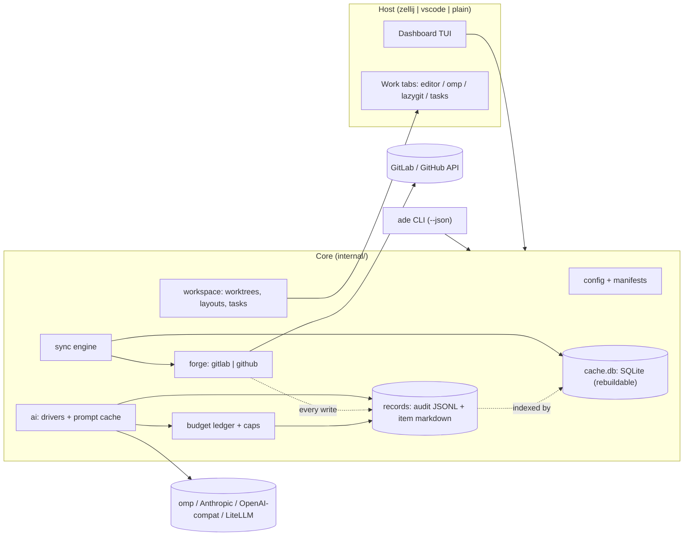
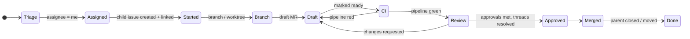

# ADE plan

Status: draft v1 · Owner: repo maintainer · Product truth: [PRODUCT.md](../PRODUCT.md)

All names in this document (`acme`, `tracker`, `api`, `web`, `jdoe`, `example.com`) are synthetic.

---

## 1. Shape of the thing

`ade` is one static Go binary with two faces:

- **CLI** (`ade <cmd> [--json]`): every capability is scriptable and usable from VS Code tasks.
- **Dashboard** (`ade` with no args): a Bubble Tea TUI running inside an ADE‑owned zellij session. Work items open as zellij tabs (editor, agent, lazygit, tasks).



**Process model.** The dashboard process owns the sync loop. Other `ade` invocations (CLI calls, agent hooks inside panes) read and write the same SQLite cache (WAL mode, `modernc.org/sqlite`, no CGO). They append to the audit log under an exclusive file lock. Agent panes report status by writing run records. The dashboard watches the records directory with fsnotify, so no daemon or socket is needed. Remote CDEs that auto‑stop lose nothing except the zellij session, and zellij session resurrection covers that.

---

## 2. Configuration (core function 4)

Two layers. Secrets never live in either file.

| Layer | Location | Shared? | Holds |
|---|---|---|---|
| User config | `~/.config/ade/config.toml` | never | identity, forges + credential *commands*, AI profiles, budgets, host/editor prefs, keymap |
| Project manifest | `*.ade.toml` (any repo or URL) | yes | tracker, repos, iteration source, conventions, tasks, workspaces |
| Local override | `*.local.toml` beside either file | never | per-machine paths, private extras (gitignored) |

```toml
# ~/.config/ade/config.toml
[user]
handle   = "jdoe"
timezone = "UTC"
workdays = ["mon", "tue", "wed", "thu", "fri"]

[forges.work]
kind      = "gitlab"
url       = "https://gitlab.example.com"
token_cmd = "pass show ade/gitlab"        # or token_env = "GITLAB_TOKEN"

[forges.personal]
kind      = "github"
token_cmd = "gh auth token"

[[manifests]]
source = "git+https://gitlab.example.com/acme/tracker.git#ade/acme.ade.toml"   # kept up to date by sync
[[manifests]]
source = "~/code/side-project/side.ade.toml"

[ai]
mode    = "ask"            # off | ask | auto
profile = "claude-sub"

[ai.profiles.claude-sub]
driver      = "omp"
cleared_for = ["public"]                       # personal subscription: never internal/confidential data

[ai.profiles.gateway]
driver      = "openai-compat"
base_url    = "https://llm.example.com/v1"     # org-approved gateway
key_cmd     = "pass show ade/llm"
cleared_for = ["public", "internal", "confidential"]

[redact]
terms_file = "~/.config/ade/redact.txt"        # customer/product names → placeholders before egress

[budget]
daily_usd        = 2.00
weekly_usd       = 8.00
confirm_over_usd = 0.25    # pre-flight confirmation threshold per action
agent_run_usd    = 1.50    # passed as --max-cost to omp runs

[host]
mode   = "auto"            # auto | zellij | vscode | plain
editor = "auto"            # auto: `code` inside VS Code terminal, else ade-nvim
glyphs = "unicode"         # unicode | nerd | ascii

[records]
dir               = "~/.local/share/ade"   # default: $XDG_DATA_HOME/ade
audit_retain      = "forever"              # or e.g. "365d"
snapshot_comments = 20                     # latest comments copied into item.md
```

```toml
# acme.ade.toml (shareable)
name  = "acme"
forge = "work"
sensitivity = "internal"   # public | internal | confidential; unset = confidential

[tracker]
project    = "acme/tracker"
board      = "Delivery"
iterations = { source = "auto" }   # auto | gitlab-iterations | milestones | labels | github-project | cadence
# labels:  { source = "labels", pattern = "Sprint::{n}", cadence = { start = "2026-01-05", length = "2w" } }

[[repos]]
path   = "acme/api"
route  = ["svc::api", "backend"]      # tracker labels that suggest this repo
[[repos]]
path        = "acme/web"
route       = ["svc::web", "frontend"]
[[repos]]
path        = "acme/billing"
route       = ["svc::billing"]
sensitivity = "confidential"          # per-repo override

[policy.confidential]                 # omit to keep the default: no AI, no agents
ai_send = ["title", "labels"]         # fields allowed to leave; code and diffs stay local
agents  = false

[conventions]
branch      = "{child_iid}-{slug}"
child_title = "{parent_title}"
child_body  = "templates/child.md"     # relative to manifest
link        = ["relates_to", "description"]   # always both: fixes today's inconsistency
mr          = { draft = true, closes = "child", mention = "parent" }

[tasks]
api  = { cmd = "make run",    cwd = "api" }
web  = { cmd = "npm run dev", cwd = "web" }
test = { cmd = "make test",   cwd = "api" }

[task_groups]
dev = { tasks = ["api", "web"], parallel = true }

[workspaces]
default = { layout = "code",  tasks = "dev" }
agentic = { layout = "agent", tasks = "dev" }
```

**Keeping things up to date.** On every sync tick, `manifests[].source` entries backed by git or a URL are refetched, so team edits propagate. Repos are mirrored to `~/ade/repos/<forge>/<path>` with `git fetch --prune`. Worktrees live at `~/ade/wt/<repo>/<branch>`. `ade doctor` validates config, tokens and scopes, tools on PATH, and host capabilities. A JSON Schema generated from the Go structs gives editor completion (taplo / VS Code Even Better TOML).

---

## 3. Domain model



- **WorkItem** = tracker issue + 0..n child issues + their MRs + pipelines + discussions. The stage is *derived* from forge data. ADE never stores it as truth.
- **Ball in court** is computed per item: `you` (unresolved threads addressed to you, red pipeline, requested changes), `reviewers`, `ci`, `nobody`. This is the scan column that answers "what do I touch next".
- **Child linking:** GitLab cannot make one issue the hierarchy child of another (only issue → task, same project). So ADE writes a cross‑project `relates_to` issue link (Free tier) *and* a description reference (`Parent: acme/tracker#128`). When reading, it accepts any of: link, description reference, work‑item hierarchy, or MR `Closes`/mentions, so inconsistent historical data still resolves. See [gitlab-api/README.md](gitlab-api/README.md).
- **Iteration window:** show the current iteration. Within `overlap` (default 1 working day) of its end, also show the next. Within `overlap` of its start, also show the previous. Working days come from `user.workdays`. Iteration sources implement one interface: `Current(now)`, `Adjacent(n)`, `Issues(it)`.

---

## 4. Local records, audit, and data sensitivity

ADE keeps three stores. They are split by what losing each one costs.

| Store | Default path | Source of truth? | Losing it means |
|---|---|---|---|
| Audit log | `$XDG_DATA_HOME/ade/audit/YYYY-MM.jsonl` | yes, append-only | action history is gone; ADE never deletes it automatically |
| Item records | `$XDG_DATA_HOME/ade/items/<forge>/<project>/<iid>/` | yes for AI output, plans, runs, and notes; the snapshot part is regenerable | paid AI work has to be bought again |
| Cache | `$XDG_CACHE_HOME/ade/cache.db` | no | one full re-sync; `ade reindex` rebuilds indexes from the two stores above |

Why not SQLite alone: the DB is a cache that migrations and `ade cache reset` are allowed to drop. Anything that cost money or human time lives in plain files that survive schema changes. Those files can be grepped, opened in nvim or VS Code, and handed to an agent as `@path`.

Why not Markdown alone: dashboard queries (by stage, court, iteration, or spend per day) need indexes. SQLite indexes the files; it does not own them.

### 4.1 Audit log

One JSON line per action. The line is appended (under `flock`, then fsync) before the result is shown, and failures and cancellations are recorded too.

```json
{"id":"01JCQ8…","ts":"2026-11-11T09:15:02Z","actor":"user","action":"forge.issue.create",
 "target":"work:acme/api#412","item":"work:acme/tracker#128","params":{"title":"Rate-limit the export endpoint","labels":["svc::api"]},
 "dry_run":false,"outcome":"ok","url":"https://gitlab.example.com/acme/api/-/issues/412"}
{"id":"01JCQ9…","ts":"2026-11-11T09:16:40Z","actor":"user","action":"ai.summarize",
 "target":"work:acme/api!233","item":"work:acme/tracker#128","outcome":"ok",
 "ai":{"profile":"claude-sub","model":"<haiku-class id>","tokens":{"in":1840,"out":160},"cost_usd":0.0026,
       "cost_source":"reported","cache_hit":false,"artifact":"items/work/acme/tracker/128/ai/20261111T091640-summary-mr233.md"}}
```

- **Actors:** `user`, `ade:sync`, `agent:<run-id>`.
- **Actions:**
  - forge writes: `forge.*`, e.g. `issue.create`, `issue.link`, `mr.create`, `mr.merge`, `thread.reply`, `thread.resolve`, `approve`, `pipeline.retry`
  - AI calls: `ai.*`, cache hits included at $0
  - agent runs: `agent.run.start` / `agent.run.end`
  - `workspace.open`, `task.run`, `config.change`, `budget.override`
  - sync: one summary line per sync run (counts, errors). Individual reads are not logged.
- **Redaction:** tokens and auth headers are never written. Prompt bodies are never written to the audit log; they live in the AI artifact. `params` pass through a redactor that knows the configured credential values and common secret patterns.
- **One spend source:** the budget ledger is a query over the `ai` fields of audit events, indexed in `cache.db`. There is no second ledger to drift.
- **Retention:** kept forever by default (`records.audit_retain`). Monthly files are easy to archive.
- **Surfaces:**
  - `ade audit [--since 1d] [--item tracker#128] [--action 'forge.*'] [--json]` and `ade audit tail`
  - TUI **Log** page: filterable; `enter` jumps to the target
  - **History** tab on the work item page

### 4.2 Item records

There is one directory per work item, keyed by the tracker issue. Child issues, MRs, plans, and runs nest under it because the work item is the unit. Items without a tracker parent (for example, a review requested on someone else's MR) get their own directory keyed by their own ref.

```
items/work/acme/tracker/128/
  item.md                                   snapshot + your notes
  ai/20261111T091640-summary-mr233.md       one file per AI output
  ai/20261111T091902-classify.md
  plans/20261111T100215-plan.md             agent plans (reviewed/approved state in frontmatter)
  runs/01JCQB…/run.md                       agent run: model, cost cap, spend, exit, commits, transcript path
```

```markdown
---
ref: work:acme/tracker#128
children: [work:acme/api#412]
mrs: [work:acme/api!233]
stage: review
iteration: Sprint 42
synced: 2026-11-11T09:12:03Z
---
<!-- ade:snapshot:begin (regenerated on sync; edits inside are overwritten) -->
# Rate-limit the export endpoint
…description, labels, assignees, latest comments…
<!-- ade:snapshot:end -->

## Notes
Free-form. ADE never edits outside the snapshot block.
```

- **AI artifacts** carry frontmatter: `feature`, `profile`, `model`, `prompt_version`, `input_hash`, `tokens`, `cost_usd`, `created`, `audit_id`. The body is the output.
  - The AI result cache resolves `input_hash` → artifact through `cache.db`.
  - If `cache.db` is lost, `ade reindex` rebuilds the mapping from frontmatter, so nothing is paid for twice.
- **Notes feed context.** Plan and draft actions can include the item's `## Notes` (shown in the pre-flight prompt preview, toggle per call).
- **Offline:** the work item page renders from `item.md` and its artifacts when the forge is unreachable or the cache is empty.
- **`ade item <ref>`** prints the record path, and `ade item <ref> --edit` opens `item.md` in the configured editor. In the TUI, `n` opens notes.
- **Privacy:** these directories hold real work data, and they live outside every repository. `ade doctor` warns if `records.dir` resolves inside a git work tree. On remote CDEs, point `records.dir` at the persistent home volume.

### 4.3 Sensitive projects

Some projects are commercially sensitive. Every AI or agent call is an *egress decision*, and that decision is made before any prompt is built.

- **Levels:** `public`, `internal`, `confidential`.
  - Set per manifest, overridable per repo.
  - A work item takes the **most sensitive** level among its tracker project and every linked child repo.
  - Anything unclassified is treated as `confidential`.
- **Precedence:** the shared manifest sets the ceiling, and user config can only tighten it. A teammate's local config cannot loosen team policy.
- **Defaults per level:**

| Level | Fields that may leave | Agent runs | Profiles allowed |
|---|---|---|---|
| public | all (title, description, comments, diffs, code) | yes | any |
| internal | all | yes | profiles whose `cleared_for` includes `internal` |
| confidential | none, unless `[policy.confidential].ai_send` grants fields | only if `agents = true` | profiles whose `cleared_for` includes `confidential` |

- **Gate order:**
  1. `ai.mode`
  2. item level → allowed fields and agent permission
  3. the profile's `cleared_for`
  4. budget
  5. redaction
  6. pre-flight preview
  7. send

  A refusal names the rule, e.g. "confidential (acme/billing): AI not permitted by acme manifest". The action stays visible but disabled. Nothing is silently hidden.
- **Redaction:** before anything is sent, terms from the local `redact.terms_file` (customer, product, and codenames) plus built‑in patterns (emails, internal hostnames, key‑shaped strings) are replaced by stable placeholders (`⟨TERM_3⟩`). Output is re‑hydrated locally. The mapping lives only in memory, and the terms file is user‑local and never committed.
- **Pre-flight preview** shows the destination host, the profile and model, the exact fields, the byte count, and the redacted prompt.
- **Egress audit:** every AI audit event records `dest_host`, `profile`, `fields`, `bytes`, and `input_hash`. `ade audit --action 'ai.*' --item …` answers "what left this machine about X".
- **Agents:**
  - Agent runs receive `--session-dir <item record>/runs/<id>`, so transcripts stay in the records store instead of the agent's global history. Explain calls use `--no-session`.
  - The tool set is restricted with `--tools` (no web fetch/search) for internal and confidential items. These omp flags are verified.
  - Drivers that cannot constrain sessions or tools are refused above `public`. Claude Code and codex equivalents are checked in Phase 6.
- **No other egress:** ADE has no telemetry. It talks only to configured forges, AI profiles, and manifest sources. `--debug-http` logs method, path, status, and timing, never bodies. Crash reports carry no payloads. ADE never starts `zellij web`.
- **Visible state:** every item shows its level as glyph + text in the list row and preview, so the user always knows which rules apply.

## 5. Forge layer

```go
type Forge interface {
    Me(ctx) (User, error)
    Capabilities(ctx) (Caps, error)                     // probed per feature, cached 24h; never inferred from tier
    AssignedIssues(ctx, scope) ([]Issue, error)        // incremental via updated_after
    Issue(ctx, ref) (IssueDetail, error)
    LinkedIssues(ctx, ref) ([]IssueLink, error)
    CreateIssue(ctx, project, IssueDraft) (Issue, error)
    LinkIssues(ctx, a, b, kind) error
    MergeRequestsFor(ctx, issueRef) ([]MR, error)
    MR(ctx, ref) (MRDetail, error)                       // pipeline, approvals, diffs meta
    Discussions(ctx, mrRef) ([]Thread, error)
    Reply(ctx, thread, body) / Resolve(ctx, thread, bool) / Approve / Merge / CreateMR / CreateBranch
    Iterations(ctx, src IterationSource) ([]Iteration, error)
    Events(ctx, user, since) ([]Event, error)            // standup + sprint review
}
```

- **GitLab first** via `gitlab.com/gitlab-org/api/client-go`. REST covers issues, links, MRs, discussions, approvals, pipelines, events, milestones, and *reading* iterations. GraphQL covers assigning iterations, iteration cadences, draft toggling, and the work‑item hierarchy (all GraphQL‑only per the docs).
- **Contract is docs-first:** no paid instance is available for development. Every endpoint, field, tier gate, and test strategy is pinned in [docs/gitlab-api/](gitlab-api/README.md), with source URLs.
  - Doc‑derived fixtures, split `free/` and `premium/`.
  - A fake GitLab with a tier switch.
  - GraphQL queries validated against GitLab.com's committed public schema.
  - An optional Free sandbox (`-tags live`).
  - `ade doctor --probe`: a read‑only *shape* check against real instances that reports field and status mismatches, never values.
- **Capabilities, not tiers:** each gated feature (iterations, cadences, approval rules, `blocks` links, scoped labels, epics) is probed and cached. The UI degrades per capability: "approved by 2" instead of "2 of 3 required", milestones instead of iterations.
- **GitHub second** via `google/go-github` + `shurcooL/githubv4` (Projects v2 iteration fields, sub‑issues, review threads).
- **Rate limits:** honour `RateLimit-*` headers when present and `Retry-After` on 429, with at most 4 concurrent requests per host. Incremental sync uses `updated_after`, because ETags are undocumented for `/api/v4`. Sync status is shown in the header, never as a modal.
- **Activity:** user events omit MR events, so standup and review data combine user events, MR lists (`updated_after`, author/reviewer), and project events.
- **Fixtures** are synthetic and doc‑derived. No captured real traffic is ever committed.

---

## 6. Surfaces (TUI) — mode: Operate

Design is settled per the impeccable flow. Before any screen is built, Phase 0 runs the visual‑world round (new‑work, Operate mode) and writes `DESIGN.md`: ANSI colour roles, glyph set and fallbacks, density, focus treatment, light/dark behaviour. The wireframes below fix **structure and behaviour only**.

Global conventions: `j/k` move, `enter` open, `esc` back, `tab` switch pane, `/` filter, `:` command palette, `?` keymap overlay, `r` refresh, `o` open in browser, `y` copy (OSC 52, so it works in VS Code and browser terminals). Breakpoints: ≥140 cols three regions, 100–139 two, <100 one with a toggled preview. Never colour‑only state.

### 6.1 Home (core functions 1, 6)

```
 acme · Sprint 42 · 2 workdays left · next: Sprint 43        synced 40s   AI $0.38 / $2.00 today
 ─ My work ─────────────────────────────────────────────── │ ─ tracker#128 ──────────────────────────
  STAGE      ITEM                                COURT     │ Rate-limit the export endpoint
 ▸ Review    #128 Rate-limit export endpoint     you  2💬  │ api#412 · !233 draft→ready · CI ✓
   CI        #131 Paginate audit log             ci   ⟳    │ Approvals 1/2 · 2 unresolved threads
   Started   #140 Retry webhook deliveries       you       │
   Assigned  #144 Remove legacy CSV path         you       │ Summary (AI · cached)
 ─ Reviews requested ───────────────────────────────────── │  Adds token-bucket limiter per tenant;
   !240  web  Dark-mode tokens            jkim  4 files    │  open question on burst size.
 ─ Sprint 42 · open (12) ─────────────── Sprint 43 (5) ─── │ Threads
   #150 Billing export timeouts    unassigned   P2         │  ● burst=50 too high?  — reviewer
   …                                                       │  ● missing test for 429 — reviewer
 enter open · s start · w workspace · a agent · ? keys
```

- Sections: **My work** (assigned, sorted by court then stage), **Reviews requested**, **Iteration** (current plus adjacent per the window rule), **Activity** (collapsed).
- Each row shows a progress track (stage glyph sequence) with the court, open thread count, and pipeline state. Progress also folds in task‑list completion from the issue body.
- The preview region shows the selected item. `enter` opens the full Work Item / MR page. Both modes exist, as requested.
- Actions: `s` start work (6.3), `w` open workspace, `a` agent menu, `c` classify, `n` notes, `S` standup, `L` log.

### 6.2 Work item / MR page (core function 2)

```
 ← Home  tracker#128 › api#412 › !233  Rate-limit export endpoint    [Overview] Threads  Diff  CI  History
 ─────────────────────────────────────────────────────────────────────────────────────────────────────
  Draft → Ready · CI ✓ 6m · Approvals 1/2 (needs: backend-owners) · mergeable after threads resolved
  Summary  (AI · haiku · $0.002 · cached until description changes)            [d] raw description
   ...
  Unresolved (2)                                     Resolved (5) ▸
   ▸ src/limit.go:42   "burst=50 too high?"  jkim · 2h    [R]eply  [x] resolve  [A] AI draft reply
```

- Tabs:
  - **Overview:** status strip, AI summary ⇄ raw description, linked parent/child
  - **Threads:** unresolved first, grouped by file, with diff context
  - **Diff:** file tree + chroma‑highlighted hunks; `D` opens `delta` in a pane
  - **CI:** jobs, failing job log tail, retry
  - **History:** this item's audit events interleaved with its AI artifacts, plans, and runs (4.1, 4.2)
- Actions: reply, resolve, approve, mark ready, merge (with an explicit confirm), retry pipeline. AI actions: summarise MR, summarise thread, draft reply, "address comments" (hands off to agent, 6.6).
- The body editor is `$EDITOR` in a zellij floating pane (or a VS Code tab), so long replies never get typed into a cramped text field.

### 6.3 Start work (tracker‑project pattern)

```mermaid
sequenceDiagram
  participant U as User
  participant A as ADE
  participant F as Forge
  participant G as git / host
  U->>A: s on tracker#128
  A->>A: suggest repo (labels → route; AI classify if enabled)
  A-->>U: preview: child issue, link, branch, draft MR, worktree, tab
  U->>A: confirm (edit any field)
  A->>F: create child issue in acme/api (iteration, labels, assignee copied)
  A->>F: relates_to link + "Parent:" reference
  A->>F: create branch 412-rate-limit-export + draft MR (Closes #412, mentions parent)
  A->>G: fetch, worktree add ~/ade/wt/api/412-rate-limit-export
  A->>G: open workspace tab (layout from manifest)
```

One confirm screen shows every write before it happens. It is idempotent: re‑running detects an existing child, branch, or MR and resumes from the next missing step.

### 6.4 Agile (core function 5)

- **Standup:** *Yesterday* is the previous working day (weekend and holiday aware).
  - Evidence comes from forge events (MRs opened, merged, and reviewed, comments, issue transitions, pushes) plus the local audit log (agent runs, plans, workspaces opened). The audit log catches work that never reached the forge.
  - *Today* covers in‑progress items ordered by court and stage, then the next items by priority in the current iteration.
  - *Blockers* are red pipelines, threads waiting on others for more than 1 day, and blocked labels.
  - Without AI it is a deterministic bullet list. With AI the same facts become a 4–6 line spoken‑style summary, saved as an artifact under `items/_standup/`.
  - `y` copies it; `ade standup --json|--md` works too.
- **Sprint review:** for the iteration window it shows done vs carried over, scope added mid‑sprint, merged MRs grouped by parent, cycle time per item (assigned → merged), and a burn‑down sparkline from close events. The optional AI narrative per parent goes into a markdown export.

### 6.5 Budget (core function 3)

- **Ledger:** derived from `ai` audit events (4.1). Each entry holds the timestamp, feature, profile, driver, model, tokens (in/out/cache), cost, cost source (`reported` | `computed` | `gateway`), cache hit, and item ref.
- **Cost sources:**
  - omp print mode (`--mode json`) reports `usage.cost.total` per turn. This was verified locally; it is list‑price equivalent even on a subscription.
  - Direct APIs: tokens × configured price table.
  - LiteLLM: response‑cost header plus `/key/info` spend and max budget [to verify in Phase 4].
- **Controls:** daily, weekly, and per‑sprint caps. Each action gets a pre‑flight estimate, with a confirm above `confirm_over_usd`. Agent runs get a hard cap (`--max-cost`). `ai.mode=off` gives a global kill switch. Sensitivity policy (4.3) is checked before budget, so a confidential item never even produces an estimate unless policy allows it.
- **Spend avoidance:** results are cached by `hash(prompt version, model, input content)`, and the cache is backed by durable artifacts (4.2). Unchanged issues and threads are never re‑summarised, even after a cache reset. Prompts are trimmed (thread diffs clipped, quoted replies collapsed). Explain calls use a minimal system prompt and no tools: omp's default prompt alone costs ~2.2k input tokens per call (observed), so ADE passes `--system-prompt` and `--no-tools`.
- **Page:** spend by day, feature, and model; remaining headroom; top costly items; the active profile with per‑role models.

**Profiles.** Roles map to model *classes*; concrete IDs are resolved at config time (`ade ai models` lists what the driver or gateway exposes).

| Profile | Driver | explain (summaries, classify, standup) | draft (replies, MR text) | plan | implement |
|---|---|---|---|---|---|
| claude-sub | omp (subscription) | Haiku‑class | Sonnet‑class | Opus‑class | Sonnet‑class |
| claude-api | anthropic | Haiku‑class | Sonnet‑class | Opus‑class | Sonnet‑class |
| openai | openai‑compat | mini‑class | flagship | reasoning‑high | codex‑class |
| kimi | openai‑compat (Moonshot) | K2‑class | K2‑class | K2 thinking | K2‑class |
| gateway‑mix | openai‑compat → LiteLLM | cheapest of mix | Sonnet‑class | best reasoning in mix | per‑team choice |

### 6.6 Agents and workspaces (core function 7)

- **Layouts** are generated zellij KDL (`--layout-string`), one tab per work item:
  - `code`: editor 60% | lazygit + shell stacked
  - `agent`: omp 60% | lazygit + tasks
  - `review`: diff/threads + delta
  - `manual`: no agent pane
- **Tasks** run as panes in a stack, or as parallel `zellij run` panes for a parallel group.
- **Plan:** ADE gathers the parent issue, child issue, comments, notes, and repo `AGENTS.md`, then starts omp in plan mode in the worktree with a seeded prompt file. The plan is saved to the item record (`plans/`, 4.2), never into the worktree, and reviewed in the TUI.
- **Run:** omp executes the approved plan with `--max-cost` and the implement‑role model. `runs/<id>/run.md` tracks state, spend, exit, and resulting commits, and every run brackets with `agent.run.start/end` audit events. lazygit opens beside the run for review. "Address comments" uses the same path, seeded with unresolved threads.
- **Agent CLI drivers:** `omp`, `claude`, and `codex` are discovered on PATH and chosen per profile.

### 6.7 Hosts and editors

| Host | Detection | Workspace | Tasks | Editor |
|---|---|---|---|---|
| zellij | default; `$ZELLIJ` set or zellij on PATH | tabs/panes via `zellij action` | panes | ade-nvim / `$EDITOR` |
| vscode | `$TERM_PROGRAM=vscode` and no zellij, or `host.mode=vscode` | `code <worktree>` new window | exported `.vscode/tasks.json` (`dependsOrder: parallel`) | `code -g file:line` |
| plain | fallback | TUI only, `cd` hints | child processes with log viewer | `$EDITOR` |

VS Code specifics:

- zellij inside the VS Code terminal uses ADE's shipped config with the non‑colliding "unlock‑first" keybinding preset.
- ADE emits a recommended `terminal.integrated.commandsToSkipShell` snippet via `ade doctor --vscode`.
- `editor=auto` opens files in the surrounding VS Code window even from a zellij pane.
- Browser terminals get the same zellij session. `zellij web` stays an option for read‑only sharing.

**ade-nvim** (Phase 3): a Nix‑wrapped Neovim (`nix run .#ade-nvim`) with `NVIM_APPNAME=ade-nvim`, so it never touches an existing config. Plugins are pinned from nixpkgs with no runtime downloads: mini.nvim (pick, files, diff, git, clue, statusline, completion), nvim‑treesitter with prebuilt grammars, and nvim‑lspconfig with native `vim.lsp`. Language servers come from each project's devshell. The target is a fast startup and a keymap that mirrors the ADE keys.

---

## 7. Code layout

```
cmd/ade/                 cobra root; `ade` → host launch, subcommands
internal/config/         schema, load/merge/override, manifest fetch, JSON Schema gen
internal/store/          cache.db (modernc SQLite), migrations, queries, reindex from records
internal/audit/          append-only JSONL writer (flock), redactor, query
internal/records/        item dirs, item.md snapshot/notes merge, AI artifacts, plans, runs
internal/forge/          interface, Caps; gitlab/ (REST + GraphQL, fake/ with tier switch, testdata/{free,premium}, schema.graphql), github/
internal/domain/         WorkItem, stage + court derivation, iteration window
internal/sync/           scheduler, incremental fetch, repo mirror, manifest refresh
internal/ai/             drivers (omp, anthropic, openaicompat), prompts/ (versioned), result cache
internal/budget/         ledger view over audit, prices, caps, estimates, gateway spend
internal/agile/          standup, sprint review
internal/workspace/      worktrees, layouts (KDL), tasks, vscode export
internal/host/           zellij, vscode, plain
internal/tui/            app shell, router, keymap, theme (from DESIGN.md); pages/, components/
nix/                     ade-nvim, zellij config
docs/                    PLAN.md, config reference
```

Verification:

- Unit tests on domain derivation (stage, court, iteration window edge cases around weekends and overlap).
- `teatest` golden tests for pages at 80×24, 120×40, and 200×50, in dark, light, and NO_COLOR.
- VHS tapes produce screenshots for design review.
- `nix flake check` runs lint and tests.

---

## 8. Phases

| # | Phase | Delivers | Acceptance |
|---|---|---|---|
| 0 | Foundations | flake (done), Go module, cobra skeleton, config load + `ade doctor`, audit writer + `ade audit`, zellij launcher (`ade` attaches/creates session `ade`), **visual‑world round → DESIGN.md** | `ade` opens a zellij session with a placeholder dashboard pane; `ade doctor --json` reports tools, config, and token checks; every command leaves an audit line |
| 1 | Read‑only home | GitLab forge (issues, links, MRs, pipelines, milestones, iterations read), capability probe + `ade doctor --probe`, fake GitLab (free/premium), committed GraphQL schema + query validation, sync + cache, item records (`item.md` snapshots), iteration sources (`auto`, milestones, labels, cadence, GitLab iterations), sensitivity resolution + badges, stage/court derivation, Home page + preview | Fake‑server tests pass in both tier modes; every GraphQL document validates against the schema; on the Free sandbox, assigned tracker issues show correct child, MR, stage, court, and milestone‑based iteration window; navigation never waits on network; notes below the snapshot survive re‑sync |
| 2 | MR page | threads, diff, CI tabs; reply, resolve, approve, ready, merge, retry | Full review round‑trip on a sandbox MR without the web UI |
| 3 | Start work + workspaces | child issue/link/branch/MR/worktree flow, layouts, tasks, VS Code host + tasks.json export, ade-nvim | `s` on a tracker issue yields linked child + draft MR + worktree + tab; re‑run is idempotent; same flow works in VS Code terminal without zellij |
| 4 | AI explain + budget | drivers (omp, anthropic, openai‑compat), sensitivity gate + redaction + egress audit, AI artifacts + result cache, ledger over audit, caps, pre‑flight, budget page, Log page + History tab, profiles, summaries/classify/draft reply | Second summary of an unchanged MR costs $0 (cache hit), also after deleting `cache.db` and running `ade reindex`; a confidential item refuses AI with the rule named and sends zero bytes; a `public`‑only profile is refused on an internal item; redacted terms never appear in captured outbound requests; cap breach blocks with a clear message; `ai.mode=off` hides nothing essential |
| 5 | Agile | standup, sprint review (deterministic + AI narrative), exports, OSC 52 copy | Standup over a Monday correctly uses Friday; review totals match forge data on the sandbox |
| 6 | Agents | plan/run/address‑comments via omp (claude/codex drivers), session dir + tool restriction per sensitivity, run tracking, cost caps, lazygit integration | Plan → approve → run → review → push completes on a sandbox issue within `agent_run_usd`; the transcript lands only in the item record; agent actions on a confidential item are refused unless the manifest sets `agents = true` |
| 7 | GitHub + team | GitHub forge parity, `ade init` onboarding, shared manifest docs, release (goreleaser + flake package) | Same Home/MR/Start flows on a GitHub sandbox repo; a teammate goes from zero to dashboard via `ade init` |

---

## 9. Risks and open decisions

- **No paid GitLab instance during development.** Premium paths (iterations, cadences, approval rules, `blocks` links) are built from the docs and the fake server alone, and confirmed later by `ade doctor --probe` (read‑only, shape‑only) on a real instance. Remaining doc gaps are listed in [gitlab-api/README.md](gitlab-api/README.md#open-questions-need-a-real-instance).
- **Subscription quota is not observable.** omp reports list‑price usage only, so subscription budgets are soft caps on that figure until a quota endpoint exists.
- **VS Code key capture.** Some chords never reach the terminal. The keymap avoids Ctrl+Shift chords and documents `commandsToSkipShell`.
- **Data egress.** AI and agent calls can send issue, MR, and code text off the machine. The controls are sensitivity levels, profile clearance, redaction, the pre‑flight preview, and the egress audit (4.3). Unclassified means confidential.
- **Local data sensitivity.** Records and audit hold real work content in plain files. They stay outside repos, are created `0700`, and are excluded from any sync ADE performs. Backups are the user's call.
- **Writes are irreversible‑ish.** Every forge write goes through a preview/confirm, and `--dry-run` is available on every write command.
- Open: diff rendering inside the TUI vs always delegating to delta (decide after the Phase 2 spike); whether run tracking needs a socket once agents run in parallel.
