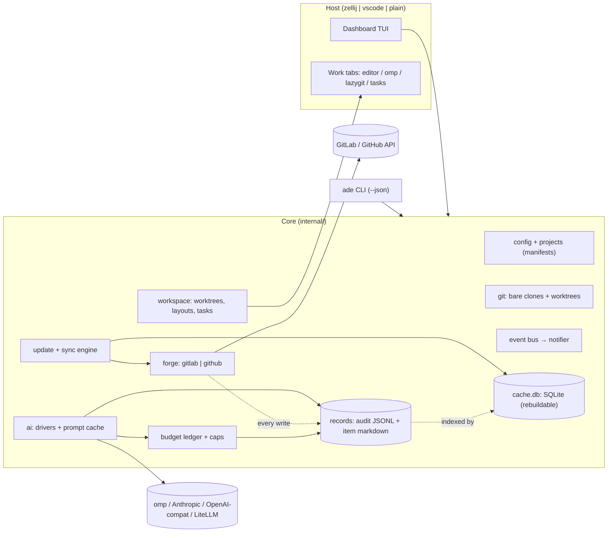
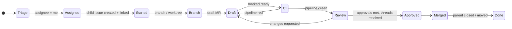

# ADE plan

Status: spec v1, implemented through Phase 7 (§8) · Owner: repo maintainer · Product truth: [PRODUCT.md](../PRODUCT.md) · Setup: [setup.md](setup.md)

All names in this document (`acme`, `tracker`, `api`, `web`, `jdoe`, `example.com`) are synthetic.

---

## 1. Shape of the thing

`ade` is one static Go binary with two faces:

- **CLI** (`ade <cmd> [--json]`): every capability is scriptable and usable from VS Code tasks.
- **Dashboard** (`ade` with no args): a Bubble Tea TUI running inside an ADE‑owned zellij session. Work items open as zellij tabs (editor, agent, lazygit, tasks).



**Process model.**

- The dashboard process owns the update/sync loop and the event bus.
- Other `ade` invocations (CLI calls, agent hooks inside panes) read and write the same SQLite cache (WAL mode, `modernc.org/sqlite`, no CGO).
- They append to the audit log under an exclusive file lock.
- Agent panes and task supervisors report status by writing run records. The dashboard turns new records into events, so a task finishing in another pane still raises a notification. No daemon or socket is needed.
  - **As built:** the other process writes an inbox row (`cache.db`) next to its run record, and the dashboard watches the cache directory with fsnotify (`internal/watch`: bursts are debounced to one signal, about 150 ms) and re‑reads the inbox, the cached work items and, while open, the agent runs. The header's AI figure re‑reads when the audit directory changes (an AI call from any ade process); the only timer is the end of the local day. Where fsnotify cannot be used (inotify limit, some network mounts) the watcher falls back to stat polling every 2 s; `ade doctor` says which is active.
- Remote CDEs that auto‑stop lose nothing except the zellij session, and zellij session resurrection covers that.
  - **`ade setup`** (unattended first start, run on every workspace boot): creates the config from flags or `ADE_SETUP_*` variables (never overwriting one), checks tokens (exit 3 when a forge step was skipped), runs add, update and sync, writes the zellij preset, reports missing tools, optionally warms dev shells (`--warm`) and starts the detached `ade` session (`--session`). It is serialised by a lock in the cache directory (docs/setup.md, Coder / CDE).
- **Startup:** every start of `ade` runs a full update (2.3) in the background while the UI renders from cache.

---

## 2. Configuration (core function 4)

Two layers. Secrets never live in either file.

**One config per machine.** Work and personal use run on different machines. Each machine has its own user config: the work machine has the GitLab forge and the gateway AI profile, and the personal machine has GitHub and the Claude subscription. Manifests are shared through git. Records and the audit log stay on the machine that produced them and are never synced.

| Layer | Location | Shared? | Holds |
|---|---|---|---|
| User config | `~/.config/ade/config.toml` | never | identity, forges + credential *commands*, AI profiles, budgets, host/editor prefs, keymap |
| Project manifest | `*.ade.toml` (any repo or URL) | yes | tracker, repos, iteration source, conventions, tasks, workspaces |
| Local override | `*.local.toml` beside either file | never | per-machine paths, private extras (gitignored) |

**Local overrides** are merged over the file they sit beside before anything is decoded or validated: `config.toml` → `config.local.toml`, `acme.ade.toml` → `acme.ade.local.toml`. Tables merge key by key, recursively, so `[repos.api]` in the override changes only the keys it names and keeps the rest of that repo. Every other value replaces the base value outright: strings, numbers, booleans, arrays (`toast = ["ci.*"]` replaces the list, it does not extend it) and arrays of tables (`[[projects]]` as a whole). Keys can be added, never removed (set the off value instead). Unknown keys in an override are reported like anywhere else, and a syntax error names the override file. A remote manifest (`git+…#path`, `https://…`) has no neighbour on disk, so its override lives in the user config directory under the manifest's file name (`shop.ade.local.toml`). The merged manifest is what the project snapshot stores, so an override takes effect at the next update. `ade config check` names the override it merged.

```toml
# ~/.config/ade/config.toml
[user]
handle   = "jdoe"
timezone = "UTC"
workdays = ["mon", "tue", "wed", "thu", "fri"]
holidays = []                          # non-working dates, "2026-12-25"; standup skips them

[forges.work]
kind      = "gitlab"
url       = "https://gitlab.example.com"
token_cmd = "pass show ade/gitlab"        # or token_env = "GITLAB_TOKEN"
# read_token_env = "GITLAB_READ_TOKEN"   # optional read-only token: reads use it, only writes use token_*

[forges.personal]
kind      = "github"
token_cmd = "gh auth token"

[paths]
root = "~/ade"                 # <root>/<project>/<repo>/{.bare, <default-branch>, <branch>…}  (2.2)

[[projects]]                   # one entry per project; the manifest defines its repos
source = "git+https://gitlab.example.com/acme/tracker.git#ade/acme.ade.toml"   # kept up to date by update
[[projects]]
source = "~/src/side-project/side.ade.toml"

[update]
on_start         = true
interval         = "10m"
feature_branches = "ff-if-clean"   # ff-if-clean | notify-only
concurrency      = 4

[notify]                       # (6.8)
toast = ["*"]                  # event kinds shown as pop-ups; every event is recorded in the inbox

[ai]
mode    = "ask"            # off | ask | auto
profile = "claude-sub"

[ai.profiles.claude-sub]                       # personal machine
driver  = "omp"
models  = { explain = "anthropic/claude-haiku-4-5", draft = "anthropic/claude-sonnet-5", review = "anthropic/claude-sonnet-5" }   # role → model id (`ade ai models`)
billing = { source = "omp", weekly_soft_usd = 10 }   # no quota API: list-price usage vs a soft cap

[ai.profiles.gateway]                          # work machine
driver   = "openai-compat"
base_url = "https://llm.example.com/v1"
key_cmd  = "pass show ade/llm"
models   = { explain = "mini", classify = "small-classifier", draft = "sonnet" }   # classify falls back to explain; review to draft, then explain
# timeout = "90s"; extra_headers = { "x-litellm-tags" = "ade" }   # optional per-request timeout and headers
billing  = { source = "litellm" }              # cost headers + /key/info
# [ai.profiles.gateway.prices.sonnet]            # optional USD per Mtok (input, output, cache_read, cache_write):
# input = 3.0                                    # pre-flight prices when neither the driver nor the gateway publishes them

[budget]
daily_usd        = 2.00
weekly_usd       = 8.00
sprint_usd       = 0       # 0 = no cap; enforced only while a sprint window is known
call_usd         = 0       # hard cap per call; also passed to omp as --max-cost
confirm_over_usd = 0.25    # pre-flight confirmation threshold per action
agent_run_usd    = 1.50    # passed as --max-cost to omp runs

[host]
mode   = "auto"            # auto | zellij | vscode | plain
editor = "auto"            # auto: `code` inside a VS Code terminal, else nvim, else $EDITOR; or ade-nvim | nvim | code | $EDITOR
glyphs = "unicode"         # unicode | nerd | ascii

[records]
dir               = "~/.local/share/ade"   # default: $XDG_DATA_HOME/ade
audit_retain      = "forever"              # or e.g. "365d"
snapshot_comments = 20                     # latest comments copied into item.md
```

```toml
# acme.ade.toml (shareable)
name  = "acme"
forge = "work"

[tracker]
project    = "acme/tracker"
board      = "Delivery"
iterations = { source = "gitlab-iterations", cadence = "Delivery" }   # cadence optional: pick one when the group has several
# other sources: auto | milestones | labels (pattern + cadence dates) | github-project | cadence
weight     = { source = "auto" }   # auto | gitlab (issue weight, Premium) | label (pattern = "weight::{value}") | github-field (field = "Estimate") | none

# Labels carry three independent facets. Patterns are per team; values come from the forge.
[labels.type]
pattern = "type::{value}"              # story | bug | … (display, filters)

[labels.app]
pattern = "app::{value}"               # value routes the issue to repos whose `app` lists it

[labels.workflow]
pattern = "workflow::{value}"          # the board column
stage   = { started = "in progress", draft = "in progress", review = "in review", merged = "done" }
sync    = "auto"                       # auto | ask | off: move the label when the derived stage changes
done    = "done"                       # optional: an open tracker carrying this value counts as done

[repos.api]
path  = "acme/api"
app   = ["api"]                         # matches `app::api`

[repos.api.tasks.migrate]
cmd      = "make migrate"
kind     = "oneshot"                     # must exit 0 before dependents start
requires = ["services.db"]
env      = { DATABASE_URL = "postgres://localhost:{services.db.port}/acme" }

[repos.api.tasks.dev]
cmd      = "make run"
port     = "auto"                        # allocated per instance; or a fixed number
env      = { PORT = "{port}", DATABASE_URL = "postgres://localhost:{services.db.port}/acme" }
requires = ["api.migrate"]
ready    = { http = "http://localhost:{port}/healthz", timeout = "60s" }

[repos.api.tasks.test]
cmd      = "make test"
kind     = "oneshot"
requires = ["services.db"]

[repos.web]
path     = "acme/web"
app      = ["web"]
requires = ["api"]                       # checkout dependency: web work also gets an api tree

[repos.web.hooks]                        # run inside the tree; failures raise notifications
post_clone    = ["npm ci"]               # once, in the baseline tree after `ade project add`
post_worktree = ["npm ci"]               # every new worktree (node_modules are per tree)

[repos.web.tasks.dev]
cmd      = "npm run dev -- --port {port}"
port     = "auto"
requires = ["api.dev"]                   # runtime dependency: api must be ready first
env      = { API_URL = "http://localhost:{api.dev.port}" }
ready    = { log = 'ready in \d+ ms', timeout = "90s" }

[services.db]                             # not a repo: shared infrastructure
cmd   = "postgres -D {state}/pg -p {port} -k {state}"
port  = "auto"
ready = { tcp = "localhost:{port}" }
keep  = true                             # survives when its last dependent stops

[conventions]
branch      = "{child_iid}-{slug}"
child_title = "{parent_title}"
child_body  = "templates/child.md"     # relative to manifest
link        = ["relates_to", "description"]   # always both: fixes today's inconsistency
child_issue = "auto"                     # auto | always | never (6.3)
mr          = { create = "ask", template = "Default", draft = true, closes = "child", mention = "parent" }   # create: ask | always | never

[groups]
dev = ["web.dev"]                       # pulls in api.dev → api.migrate → services.db

[workspaces]
default = { layout = "code",  run = "dev" }
agentic = { layout = "agent", run = "dev" }
```

`ade doctor` validates config, tokens and scopes, tools on PATH, and host capabilities. A JSON Schema generated from the Go structs gives editor completion (taplo / VS Code Even Better TOML): `ade config schema` prints the user config schema and `--manifest` the manifest one. Both are committed under `docs/schema/` (`#:schema …/config.schema.json` on the first line of a file) and a test fails when they are stale; `ade config schema --write docs/schema` regenerates them.

### 2.1 Repo and task dependencies

A frontend that needs a running API is the normal case, not an edge case. ADE models it as two separate dependency graphs that it validates together.

**Checkout graph (`repos.<r>.requires`).** Opening a workspace for a repo also prepares a tree for every repo it requires, transitively. Tree resolution, per required repo:

1. **Explicit pin:** `ade ws up --with api=some-branch` (a branch or worktree path; also selectable in the TUI before opening). A pin always wins, so web can be run against `main` even when the work item has its own api tree.
2. **Same work item:** if the work item has its own child and branch in that repo, ADE uses that worktree. This is how a cross‑repo change gets web running against the *feature* API, not `main`.
3. **Baseline:** otherwise the repo's baseline worktree, named after its default branch (2.2), kept current by the update loop (2.3).

**Run graph (`tasks.*.requires`, `services.*`).** Nodes are tasks (`<repo>.<task>`) and services (`services.<name>`). Edges are `requires`. Each node declares:

- **`kind`:** `service` (default; long‑running) or `oneshot` (must exit 0, e.g. migrations or codegen).
- **`ready`:** one of `http` (2xx), `tcp` (port open), `log` (regex on output), or exit 0 for oneshots, with a `timeout`.
- **`port`:** `auto` allocates a free port per instance; a fixed number is used as is.
- **`env`:** values can reference other nodes: `{port}`, `{dir}`, `{state}`, `{<repo>.dir}`, `{<repo>.<task>.port}`, `{services.<name>.port}`. This is how `API_URL` in web always points at the api instance actually serving this workspace.

**Instances and sharing.** A running instance is identified by (node, tree):

- Two workspaces that resolve to the same api tree share one api instance, reference‑counted. A workspace with its own api feature tree gets its own instance on its own port. Nothing collides, and nothing starts twice.
- When the last dependent stops, the instance stops, unless the node sets `keep = true` (typical for databases).
- Instances, ports, and PIDs are written to the item's run records (4.2) and shown in a **Services** strip on the workspace and Home preview: `db ● 54012 · api ● 54031 (feature tree) · web ◌ waiting on api`.

**Start order and failure.**

- Start order is a topological sort. Independent nodes start in parallel.
- A dependent starts only after all of its requirements are ready.
- If a requirement fails or times out, its dependents are not started. Each one shows `blocked: api.dev not ready (timeout 60s, last log line …)`. `r` restarts that subtree.
  - **As built:** `ade ws restart <node> [worktree]` (and `r` on a blocked service in the Services strip, which names the blocker) stops the node's instance together with everything in the workspace's plan that requires it, dependents first, then starts them again in dependency order and waits until each is ready. Other instances keep running. Holds are kept: whoever held a restarted instance (another workspace, a foreground `ade ws up`) still holds it, and an instance nobody held is held by the restarting worktree. A node whose requirement outside the subtree is not running stays blocked instead of starting against it. Dependents that belong to another workspace's plan are not part of the plan and are restarted from their own workspace.
- If a requirement dies *after* its dependents came up (api killed while web runs), the dependents keep running but are reported `blocked` (`ade ws status` shows `blocked by api.dev`, JSON `state: "blocked"` + `blocked_by`), and a foreground workspace (`ade ws up --no-zellij`, `ade task run`) raises one `task.blocked` warning per dependent. Nothing is restarted automatically.
- Stopping a node stops its dependents first, in reverse order.

**Validation (load time and `ade config check`):**

- unknown references
- cycles, reported with the cycle path
- `env` templates that reference nodes outside the node's `requires` closure (so ordering can't be violated silently)
- fixed‑port clashes between nodes
- a `requires` on a repo in another loaded manifest must be qualified (`shared/auth.dev`); unqualified names resolve within the same manifest only

**Where else dependencies show up:**

- **Start work (6.3):** if the routed repo requires another, the confirm screen offers to also create a child issue there ("web requires api: create api child too?"). It is off by default.
- **Agents (6.6):** required repos' trees are passed with `--add-dir` (verified omp flag), so plans and runs can read the API contract while they write only the routed repo.
- **Merge order (3):** when one work item has open MRs in both repos and web requires api, the web MR shows `waits on api!N` until the api MR merges. Its court becomes `api!N` instead of `you`.
- **Hosts (6.7):** zellij gets one pane per instance, with requirements in a stacked "services" pane. VS Code gets generated `tasks.json` with `dependsOn`, `isBackground`, and a `background.endsPattern`: the node's own regexp for `log` readiness, and for `http`/`tcp` (or no probe) the `ade: ready <node>` line that `ade task run <node>` prints once the probe passes. Panes and VS Code tasks both run nodes through `ade task run`, so an instance another workspace already started is reused, never started twice. On the plain host, `ade ws up --no-zellij` supervises the processes itself.

### 2.2 Projects, clones, and worktrees

ADE manages several projects at once. Each project is one manifest, and each manifest lists any number of repos. Every repo is a bare clone plus git worktrees. Nothing is ever checked out in place.

```
~/ade/                                   paths.root
  acme/                                  project (manifest `name`)
    .project.toml                        resolved manifest snapshot + source + last update
    api/
      .bare/                             bare clone; fetch refspec set to refs/remotes/origin/*
      .git                               "gitdir: ./.bare", so git and lazygit work from api/
      main/                              baseline worktree, named after the default branch
      412-rate-limit-export/             one worktree per work-item branch
    web/
      .bare/  .git  develop/  418-paginate-audit-log/
  side/
    …
```

- **`ade project add <source>`:**
  1. Fetch and validate the manifest (2.1 checks included).
  2. Create `<root>/<project>/`.
  3. Clone every repo in parallel (bounded by `update.concurrency`), with per‑repo progress.
  4. Add each baseline worktree (named after the default branch).
  5. Run `post_clone` hooks.

  It is idempotent: re‑running it fills in whatever is missing. A failure in one repo does not stop the others; each failure becomes a `git.clone.failed` notification. `ade project list|status|remove` complete the set.
- **`ade project remove <name> [--dry-run] [--yes] [--force]`** unregisters the project (its `[[projects]]` block is cut from the config; comments and other projects stay) and deletes `<root>/<name>`. The guard is the one `ade gc` uses for local state, applied to every worktree including the baseline and to every local branch that has no worktree: it refuses when a tree has uncommitted changes or commits no remote branch has, says where, and exits 2. `--force` deletes anyway. Without `--yes` it asks; with no terminal (a pipe, a script, `--json`) it refuses instead of guessing. Item records and the audit log are not touched, and the removal is audited.
- **Bare‑clone pitfall (verified in a throwaway clone of the GitHub sandbox):** `git clone --bare` creates a local branch for every remote head, with no upstream and no remote‑tracking refs. So after cloning, ADE:
  1. sets `remote.origin.fetch` to `+refs/heads/*:refs/remotes/origin/*`
  2. fetches
  3. deletes the clone‑created local heads except the default branch

  New worktrees are then created with `git worktree add --track -b <branch> <dir> origin/<branch>`, or from `origin/<default>` for a new branch, so every worktree has a real upstream.
- **Worktree lifecycle:**
  - **Start work** creates the branch's worktree, then runs `post_worktree` hooks.
  - **Opening a workspace** reuses an existing worktree, never re‑creating it.
  - **When the MR merges**, a `worktree.removable` notification (next to `mr.merged`, which is not raised for merges you did yourself) offers to remove the worktree: its title names the worktree and the command, its detail holds the exact commands (`ade gc --yes`, or `git -C <bare> worktree remove <path>` for just that tree). It is raised only when the tree is clean and fully pushed, so the offer can always be accepted.
  - **`ade gc [--dry-run] [--yes] [--project <name>]`** removes worktrees whose merge request is merged or closed, and only when the tree is clean and everything committed is pushed. Every tree that stays says why in one line: MR still open, no MR for the branch, uncommitted changes, N commits not pushed, detached HEAD, forge unreachable. The merge requests are read from the forge (`ListMRs` by source branch, every state); the rest is local. "Pushed" means the tree is not ahead of its upstream. A branch without an upstream (deleted after the merge, or never set) counts as pushed only when HEAD is the head commit the forge reports for one of the branch's merge requests, or HEAD is on a remote branch that still exists: gc runs `git fetch --prune` once per such repo first, so a stale remote-tracking ref cannot vouch for it. Otherwise the tree stays ("commits not on any remote branch (never pushed)"). A tree whose status git cannot read stays too. `--dry-run` shows for each tree to remove why it counts as pushed (`pushed: HEAD is api!12's head`, `pushed: on origin/develop`). The baseline tree and open-MR branches are never touched. Removal never forces (git itself refuses a tree that went dirty since) and also deletes the local branch when git agrees it is merged, else keeps it and says so. Without `--yes` it asks; with no terminal it refuses. Removals are audited as `worktree.remove`.
  - The worktree path is what tabs, tasks, agents (`--cwd`), and editors receive; `ade cd <item-ref|repo> [--repo <name>] [--json]` prints it for the shell (`cd "$(ade cd 412)"`): one absolute path on stdout, messages on stderr, non-zero exit with empty stdout on failure (use `adecd() { d=$(ade cd "$@") && cd "$d"; }`: `cd ""` succeeds, so a bare `cd "$(ade cd 412)"` stays put on failure). A bare number reads the project snapshot, never the network. An item resolves like `ade vscode workspace` (cache and file system only) to its worktree in the primary repo, or in `--repo`; a repo name (`api`, `<project>/api`) prints the baseline tree; a ref (anything with `#`/`!`, or a bare number) wins over a repo name.
- **Same repo in two projects:** each project gets its own bare clone. This is simple and isolated; disk usage is the cost.
- **Repos and lazygit:** lazygit opens in the worktree directory and works unchanged. The `.git` file at the repo root makes `<root>/<project>/<repo>/` usable for repo‑wide commands such as `git worktree list`.
- **Writing the manifest:** `ade project bootstrap --forge <name> --group <path>` generates one from an existing forge group, through the forge API only (no clone): repos (archived skipped), tracker, label patterns and the workflow stage map, iteration and weight sources, MR templates, and run tasks from each repo's root files (`go.mod`, `package.json`, `Makefile`, `Procfile`, `flake.nix`). It states only what it detected, comments the rest, validates the result before writing, never overwrites without `--force`, and with `--publish` opens an idempotent MR adding `.ade.toml` to the tracker repo. See [manifest.md](manifest.md#bootstrapping-a-manifest).

### 2.3 Startup and periodic update

Every `ade` start (`update.on_start`), every `update.interval`, and on demand (`U` in the TUI, `ade update`), ADE runs the following. Repos update in parallel; the UI never blocks; progress shows in the header.

1. **Projects:** refetch each `[[projects]].source` (git or URL) and re‑validate. An invalid new manifest is rejected, the last good snapshot stays in use, and a `project.manifest.invalid` notification names the error.
2. **New repos** in a manifest are cloned (as in `project add`). Repos removed from a manifest are flagged in `ade project status`, never deleted.
3. **Fetch:** `git fetch --prune` in every bare clone.
4. **Baseline tree (default branch):** fast‑forward only, and only if the tree is clean. If it is dirty or has diverged, it is left untouched and a `git.pull.skipped` notification gives the reason.
5. **Feature worktrees:** with `ff-if-clean`, a tree that is clean and strictly behind its upstream is fast‑forwarded (for example, after an agent pushed from another tree, or a reviewer pushed a fix). Anything dirty, ahead, or diverged is never touched. It shows `↑2 ↓1` and raises a notification. ADE never merges, rebases, or stashes on its own. `notify-only` skips step 5's writes entirely.
6. **Forge sync:** issues, MRs, pipelines, and discussions (incremental), then derived stage and court. In the dashboard it starts when the git update (steps 1–5) reports done, so what the sync writes is read against fetched git state; a sync requested while an update runs is queued behind it.
7. **One summary event:** `git.update.done` ("pulled 6 repos · 1 skipped (web/main dirty) · 1 failed (api: auth)"). Each failure is its own `git.*.failed` event, with the git stderr in the inbox detail.

---

## 3. Domain model



- **WorkItem** = tracker issue + 0..n child issues + their MRs + pipelines + discussions. The stage is *derived* from forge data. ADE never stores it as truth.
- **Ball in court** is computed per item: `you` (unresolved threads addressed to you, red pipeline, requested changes), `reviewers`, `ci`, `nobody`. This is the scan column that answers "what do I touch next".
- **Merge order:** if a work item has open MRs in two repos and one repo `requires` the other (2.1), the dependent MR's court is the upstream MR (`waits on api!N`) until that merges.
- **Child linking:**
  - **GitLab** nests only some pairs of work item types in its hierarchy (an issue under an epic, a task under an issue), so an issue in a code repo usually cannot be the hierarchy child of a tracker issue. ADE writes a cross‑project `relates_to` issue link (Free tier) *and* a description reference (`Parent: acme/tracker#128`), then tries the hierarchy through GraphQL (`workItemUpdate` with a `hierarchyWidget` parent) and records a warning, not a failure, if GitLab refuses. A refusal of the pair of types is remembered for a week per pair of projects; other errors are not.
  - **Finding the parent:** for every code‑repo issue listed (closed ones and teammates' included), ADE reads the hierarchy parent (GraphQL `group.workItems`, up to 25 issues per request, following `pageInfo` when homonyms overflow a page, skipped silently where the instance lacks it), then the `Parent:` line, then a `relates_to` link from the child to a tracker issue. The parent is fetched even when it is not yours and is outside the sprint window, so the child sits under it as one My work entry. Optional `forge.Parenter` carries this; GitHub does not implement it.
  - **GitHub** supports real cross‑repo sub‑issues. This was verified on the sandbox, so ADE uses them plus the same description reference.
  - **Reading** accepts any of: link, sub‑issue/hierarchy, description reference, or MR/PR `Closes`/mentions, so inconsistent historical data still resolves. See [gitlab-api/README.md](gitlab-api/README.md).
- **Labels:** three facets, each described by a pattern in the manifest (2):
  - **type** (story, bug, …): shown as a glyph and word on every row, and used for filters.
  - **app**: the routing signal. Every `app` value on a tracker issue maps to the repos that list it. More than one value means a cross‑repo work item, and Start work offers a child in each.
  - **workflow**: the team's board column. ADE derives the stage from forge facts (child, branch, MR, CI, approvals) and moves the label to match when `sync = "auto"`. Unset means `ask`: `ade start` moves it with `--move-label` (or the start dialog's `l` toggle), and a background sync only reports the change as a warning and an inbox event.
    - Every move removes the old workflow label explicitly, because `::` labels are not exclusive on Free (verified) and ADE can't rely on scoped‑label exclusivity. Each move is audited.
    - Moves are edge‑triggered: they happen only when the derived stage *changes*. A label someone sets by hand stays until the next transition, and meanwhile any contradiction shows as drift (`label: in review · MR still draft`). `ask` moves a label only when `ade start` is told to (`--move-label` or the dialog toggle); `off` only shows drift.
    - **Done but kept open:** some teams leave sprint work open until the sprint review and mark it finished with a workflow label instead. With `labels.workflow.done` set, an open tracker carrying that value (and no open MR) is done: hidden from active Home rows, counted in done weight and sprint review, court `nobody · done · issue kept open`, never nagged to close. A merged item without the label asks for it (`you · set workflow::done`), and `sync = "auto"` applies it when `stage.merged` maps to the same value. The done value outranks other workflow labels that coexist on Free. A done label on an item whose MR is still open is ahead of the work: the item keeps its real stage and shows drift.
  - **Unmatched issues:** issues missing a type or app label appear in a "needs triage" filter. `c` (classify) suggests the missing labels, deterministically from title and description keywords, or with AI when it is enabled. Labels are applied only on confirm.
- **Epics:** teams differ, so nothing is assumed. Where tracker issues have a parent epic (GitLab group‑level epics, Premium), ADE shows the epic title on the row and preview, and can group sprint review by it. It reads the epic through the work‑item hierarchy widget and gates it by capability. ADE never creates or edits epics.
- **No team convention is hard‑coded.** Label patterns, workflow values, cadence choice, child‑link style, and branch naming all come from the manifest, because they vary between teams even inside one company.
- **Weights:** issues carry a weight (story points). Sources, chosen by `tracker.weight.source`:
  - GitLab's issue `weight` field (Premium; capability‑probed)
  - a label pattern (`weight::{value}`) for Free tiers
  - a GitHub Projects number field
  - `none`

  `auto` probes in that order. Weight appears on every row and preview, and it is copied to the child issue on Start work when the child's project supports it. Weight totals drive sprint load and sprint review (6.4).
  - **Missing weight:** a tracker issue without one counts as unweighted, never as 0, and joins the "needs triage" filter. `c` suggests a weight from similar closed issues of the same type and app; nothing is applied without confirm. **As built:** the suggestion is always deterministic and never asks the model: the score-weighted median of the weights of the five closest closed issues with the same type and app (the dimensions the issue has; suggested labels stand in for missing ones), so it is a weight the team really used. Closeness is the summed rarity (IDF over all samples) of the title words two issues share; stop words such as add, fix, update and page do not count, and a sample needs two shared words or one strictly rarer than the median word. On an even split it takes the weight nearer the weighted mean. With only one similar issue the reason says so (`only one similar issue: ref (weight)`); otherwise it lists the nearest three as `ref (weight)`. History samples are windowed on the issue's closed date when the forge gives one. It is in the Classify dialog and in `ade ai classify --json` (`suggestion.weight`, `weight_reason`).
  - **Explicit writes:** changing a weight is an explicit, audited action (`ade issue weight <ref> <n|none> [--dry-run] [--no-child]`, or `=` in the TUI, which shows the writes first). **As built:** the weight field is written (GraphQL `issueSetWeight`, which can also clear it) where `tracker.weight.source` is `gitlab` or `auto` and the forge licenses it; otherwise the label pattern is swapped and every old weight label is removed explicitly. The child issue start work made follows unless `--no-child`. A weight is 1 or more (`none` clears; 0 would read as unweighted). Every write is one `forge.issue.weight` audit entry (`from`, `to`, `mode`, `add`, `remove`, `child`).
- **Moving to the next sprint:** the project lead closes issues, so ADE only carries unfinished work forward, never bulk-closes. `ade issue move <ref> [--to next|<sprint title or key>] [--with-children|--no-children] [--dry-run] [--json]`, `>` on a Home item, and on the Sprint review page `>` (the selected carried item, picked with `J`/`K`) and `M` (every unfinished item assigned to you) show the exact writes in a confirm dialog (from → to, the children listed) before anything is written. **As built:** the destination's source decides the write: an iteration (GraphQL `issueSetIteration`, Premium), a milestone (REST `milestone_id`, GitHub by number), or the `Sprint::{n}` label swapped with the old sprint labels removed explicitly. `next` is the first sprint starting after the issue's own sprint that has not ended (for an issue in the current sprint that is the window's next sprint; work left in a past sprint goes to the current one); an issue in no sprint gets the window's next. ADE creates no sprint: when there is none the error names what to create (the next milestone, the cadence's next iteration, the next label). Child issues that carry the same sprint as the tracker issue follow by default; `--with-children` moves all open children, `--no-children` (`c` in the dialog) none. Each write is one `forge.issue.sprint` audit entry (`from`, `to`, `mode`, `add`, `remove`, `child`); the move raises `issue.iteration_changed` locally right away and is written into the sync cache, so the next sync does not raise it a second time. Closed issues stay in their sprint.
- **Iteration window:** show the current iteration. Within `overlap` (default 1 working day) of its end, also show the next. Within `overlap` of its start, also show the previous. Working days come from `user.workdays`. Iteration sources implement one interface: `Current(now)`, `Adjacent(n)`, `Issues(it)`.
  - **GitLab iterations (primary at work):**
    - Find them with `GET /groups/:id/iterations?state=current|upcoming|closed&include_ancestors=true`, narrowed to one cadence by `search=<cadence>&in=cadence_title` when configured.
    - List issues by `iteration_id`.
    - Iterations created by an automatic cadence have `title: null`, so ADE labels them `<cadence> · 3–14 Nov`.
    - Start work copies the parent's iteration to the child with GraphQL `issueSetIteration`, since REST has no iteration write.
  - Iterations are Premium, so they are tested against the fake server's premium mode and confirmed at work by `ade doctor --probe`. The Free sandbox exercises the same window logic through milestones.
  - Cadences can start on any weekday. GitLab's `due_date` is an iteration's last day, and the next iteration starts the following day. So the header reads `ends Mon 16 Nov · next starts Tue 17`, and "within 1 working day of the end" counts back from `due_date`. Tests cover cadences that start mid‑week, weekends inside an iteration, and 1/2/3/4‑week lengths.

---

## 4. Local records and audit

ADE keeps three stores. They are split by what losing each one costs.

| Store | Default path | Source of truth? | Losing it means |
|---|---|---|---|
| Audit log | `$XDG_DATA_HOME/ade/audit/YYYY-MM.jsonl` | yes, append-only | action history is gone; ADE never deletes it automatically |
| Item records | `$XDG_DATA_HOME/ade/items/<forge>/<project>/<iid>/` | yes for AI output, plans, runs, and notes; the snapshot part is regenerable | paid AI work has to be bought again |
| Cache | `$XDG_CACHE_HOME/ade/cache.db` | no | one full re-sync; `ade reindex` rebuilds indexes from the two stores above |

Why not SQLite alone: the DB is a cache that migrations and `ade cache reset` are allowed to drop (`ade cache reset [--yes] [--dry-run]` deletes it, rebuilds the AI result cache and the ledger from the records at once, and first says how many unsubmitted review drafts and unread notifications go with it; it refuses while workspace instances are running). Anything that cost money or human time lives in plain files that survive schema changes. Those files can be grepped, opened in nvim or VS Code, and handed to an agent as `@path`.

Why not Markdown alone: dashboard queries (by stage, court, iteration, or spend per day) need indexes. SQLite indexes the files; it does not own them.

### 4.1 Audit log

One JSON line per action. The line is appended (under `flock`, then fsync) before the result is shown, and failures and cancellations are recorded too.

```json
{"id":"01JCQ8…","ts":"2026-11-11T09:15:02Z","actor":"user","action":"forge.issue.create",
 "target":"work:acme/api#412","item":"work:acme/tracker#128","params":{"title":"Rate-limit the export endpoint","labels":["svc::api"]},
 "dry_run":false,"outcome":"ok","url":"https://gitlab.example.com/acme/api/-/issues/412"}
{"id":"01JCQ9…","ts":"2026-11-11T09:16:40Z","actor":"user","action":"ai.summarize",
 "target":"work:acme/api!233","item":"work:acme/tracker#128","outcome":"ok",
 "ai":{"profile":"claude-sub","model":"<haiku-class id>","tokens":{"in":1840,"out":160},"cost_usd":0.0026,
       "cost_source":"reported","cache_hit":false,"artifact":"items/work/acme/tracker/128/ai/20261111T091640-summary-mr233.md"}}
```

- **Actors:** `user`, `ade:sync`, `agent:<run-id>`.
- **Actions:**
  - forge writes: `forge.*`, e.g. `issue.create`, `issue.link`, `mr.create`, `mr.merge`, `thread.reply`, `thread.resolve`, `approve`, `pipeline.retry`
  - AI calls: `ai.*`, cache hits included at $0
  - agent runs: `agent.run.start` / `agent.run.end`
  - `workspace.open`, `task.run`, `config.change`, `budget.override`
  - sync: one summary line per sync run (counts, errors). Individual reads are not logged.
- **Redaction:** tokens and auth headers are never written. Prompt bodies are never written to the audit log; they live in the AI artifact. `params` pass through a redactor that knows the configured credential values and common secret patterns.
- **One spend source:** the budget ledger is a query over the `ai` fields of audit events, indexed in `cache.db`. There is no second ledger to drift.
- **Retention:** kept forever by default (`records.audit_retain`). Monthly files are easy to archive. With `audit_retain = "365d"` every command prunes whole monthly files whose last day is older than that; a month that still holds an entry inside the window stays whole, the current month is never touched, and each prune is itself an `audit.prune` line.
- **Surfaces:**
  - `ade audit [--since 1d] [--item tracker#128] [--action 'forge.*'] [--json]` and `ade audit tail [-n 10] [--follow]` (the newest entries, then new ones as any ade process appends them; `--json` is JSONL)
  - TUI **Log** page: filterable; `enter` jumps to the target
  - **History** tab on the work item page

### 4.2 Item records

There is one directory per work item, keyed by the tracker issue. Child issues, MRs, plans, and runs nest under it because the work item is the unit. Items without a tracker parent (for example, a review requested on someone else's MR) get their own directory keyed by their own ref.

```
items/work/acme/tracker/128/
  item.md                                   snapshot + your notes
  ai/20261111T091640-summary-mr233.md       one file per AI output
  ai/20261111T091902-classify.md
  plans/20261111T100215-plan.md             agent plans (reviewed/approved state in frontmatter)
  runs/01JCQB…/run.md                       agent run: model, cost cap, spend, exit, commits, transcript path
  runs/01JCQC…/run.md                       workspace run (kind: workspace): worktree, branch, instances with ports and pids; metadata only
```

```markdown
---
ref: work:acme/tracker#128
children: [work:acme/api#412]
mrs: [work:acme/api!233]
stage: review
iteration: Sprint 42
synced: 2026-11-11T09:12:03Z
---
<!-- ade:snapshot:begin (regenerated on sync; edits inside are overwritten) -->
# Rate-limit the export endpoint
…description, labels, assignees, latest comments…
<!-- ade:snapshot:end -->

## Notes
Free-form. ADE never edits outside the snapshot block.
```

- **AI artifacts** carry frontmatter: `feature`, `profile`, `model`, `prompt_version`, `input_hash`, `tokens`, `cost_usd`, `created`, `audit_id`. The body is the output.
  - The AI result cache resolves `input_hash` → artifact through `cache.db`.
  - If `cache.db` is lost, `ade reindex` rebuilds the mapping from frontmatter, so nothing is paid for twice.
- **Notes feed context.** Plan, run and address‑comments prompts include the item's `## Notes` (the tracker issue's and its child's), and so do the AI summarize, draft‑reply and review inputs (the MR's own record, the issue it closes, and that issue's `Parent:` tracker). **As built:** notes are on by default and part of the prompt, so part of the result‑cache key (editing them buys a new answer, `--no-notes` another); previews say `includes your notes` (`--dry-run` text and JSON `includes_notes`, the agent dry run, the pre‑flight line of the TUI). `--no-notes` on every `ade ai` and `ade agent` start command; in the TUI the agent menu toggles them with `n`.
- **Workspace run records.** `ade ws up --no-zellij` and `ade task run` write `runs/<id>/run.md` into the item whose child issue or MR owns the worktree's branch (frontmatter `kind: workspace`, state running, stopped, detached or failed, plus a table of instances). Env values, commands and output are never written, and a baseline tree belongs to no item, so it writes nothing.
- **Offline:** the work item page renders from `item.md` and its artifacts when the forge is unreachable or the cache is empty.
- **`ade item <ref>`** prints the snapshot, the notes and the record path (`--json` the same as fields; no network), and `ade item <ref> --edit` opens `item.md` in the configured editor at the notes (`host.editor`, else `$VISUAL`/`$EDITOR`) and prints them afterwards. In the TUI, `n` opens the notes dialog (`e` edits in the editor). A record is created by the first sync that sees the item: `--edit` on an item with none says so.
- **Privacy:** these directories hold real work data, and they live outside every repository. `ade doctor` warns if `records.dir` resolves inside a git work tree. On remote CDEs, point `records.dir` at the persistent home volume.

### 4.3 Data handling

There is no per‑project sensitivity policy. Work runs inside closed environments, and AI goes wherever that machine's profiles point (decided 2026‑11‑11). These cheap protections stay:

- AI audit events record `dest_host` and `bytes`, so "what left this machine" is always answerable.
- Agent runs keep their transcripts in the records store, not in the agent's global history. Explain calls use `--no-session`.
  - **As built:** agent runs also use `--no-session`, and ADE captures the agent's JSON stream itself into `<item record>/runs/<id>/transcript.jsonl` while it supervises the run (cost cap, tool events, `run.md`). `--session-dir` would leave the transcript in whatever format the agent CLI writes; capturing the stream gives one `transcript.jsonl` layout for all three drivers (omp, claude, codex), and the supervisor already reads that stream for the cost cap.
- **Read and write tokens (as built):** a forge may name a read-only token (`read_token_env` / `read_token_cmd`) beside its token. Each driver picks the token per request: GET/HEAD and GraphQL queries use the read token; every other method and GraphQL mutations use the write token, which is resolved on the first write only. Git clone and fetch over https use the read token, `git push` the write token. Agent processes (agent runs and the work tab's agent pane, through `env -u`) start without the write token's `token_env` variable when a read token is set. That is hygiene, not a boundary: a process running as the same user can still run a `token_cmd` or read its parent's environment. `ade doctor` checks both tokens, that the read token cannot write, and that both authenticate the same user.
- ADE has no telemetry. `--debug-http` (a global flag) logs one request line and one response line per forge and AI HTTP call to stderr: method, URL with credential query values masked, status, timing, and which credential header was sent, never its value or any body. ADE never starts `zellij web`.

## 5. Forge layer

**Scope:** ADE is built for work, on GitLab; that is where depth and polish go. The GitHub driver exists for personal GitHub projects and covers the same core flows (Home, MR/PR page and review, start work), but GitHub‑only features (Projects v2 iterations and fields, richer parity) are not a goal.

```go
type Forge interface {
    Me(ctx) (User, error)
    Capabilities(ctx) (Caps, error)                     // probed per feature, cached 24h; never inferred from tier
    AssignedIssues(ctx, scope) ([]Issue, error)        // incremental via updated_after
    Issue(ctx, ref) (IssueDetail, error)
    LinkedIssues(ctx, ref) ([]IssueLink, error)
    CreateIssue(ctx, project, IssueDraft) (Issue, error)
    LinkIssues(ctx, a, b, kind) error
    MergeRequestsFor(ctx, issueRef) ([]MR, error)
    MR(ctx, ref) (MRDetail, error)                       // pipeline, approvals, diffs meta
    Discussions(ctx, mrRef) ([]Thread, error)
    Reply(ctx, thread, body) / Resolve(ctx, thread, bool) / Approve / Merge / CreateMR / CreateBranch
    Iterations(ctx, src IterationSource) ([]Iteration, error)
    Events(ctx, user, since) ([]Event, error)            // standup + sprint review
}
```

- **GitLab first** with ADE's own REST/GraphQL client (`internal/forge/gitlab`). REST covers issues, links, MRs, discussions, approvals, pipelines, events, milestones, and *reading* iterations. GraphQL covers assigning iterations, iteration cadences, draft toggling, and the work‑item hierarchy (all GraphQL‑only per the docs).
- **Contract is docs-first:** no paid instance is available for development. Every endpoint, field, tier gate, and test strategy is pinned in [docs/gitlab-api/](gitlab-api/README.md), with source URLs.
  - Doc‑derived fixtures, split `free/` and `premium/`.
  - A fake GitLab with a tier switch.
  - GraphQL queries validated against GitLab.com's committed public schema.
  - An optional Free sandbox (`-tags live`).
  - `ade doctor --probe`: a read‑only *shape* check against real instances that reports field and status mismatches, never values.
- **Capabilities, not tiers:** each gated feature (iterations, cadences, approval rules, `blocks` links, scoped labels, epics) is probed and cached. The UI degrades per capability: "approved by 2" instead of "2 of 3 required", milestones instead of iterations.
- **GitHub second** with ADE's own client (`internal/forge/github`) (Projects v2 iteration fields, sub‑issues via `POST /repos/{o}/{r}/issues/{n}/sub_issues`, review threads).
- **As built (own HTTP clients):** both drivers are thin clients over `net/http` instead of `client-go` / `go-github` + `githubv4`. ADE uses a small slice of each API (the endpoints and fields pinned in [docs/gitlab-api/](gitlab-api/README.md)), the fake servers and the committed GraphQL schema validate exactly that slice, and the same client owns the rate‑limit gate (`Retry-After`, at most 4 in flight per host), pagination, redacted errors and the `--debug-http` transport. Generated SDKs would add their model churn and a second place to enforce all of that for no endpoint ADE calls.
- **Rate limits:** honour `RateLimit-*` headers when present and `Retry-After` on 429, with at most 4 concurrent requests per host. Incremental sync uses `updated_after`, because ETags are undocumented for `/api/v4`. Sync status is shown in the header, never as a modal.
- **Sync cost (as built):** the detail of every open MR (pipeline, approvals, reviewer verdicts, every conversation with its note authors) is one GraphQL request per project, up to 25 MRs each (`queries/mr_details.graphql`, validated against the committed schema), instead of four REST calls per MR. On the sandbox a first sync went from 61 requests to 31 (`scripts/verify/r3-freshness.sh` asserts the count and that no per-MR REST read remains). An instance whose GraphQL cannot answer the document (an older self-managed release missing a field, GraphQL disabled) is remembered per client and read through the REST calls; a conversation too long for the first page falls back for that MR only. Approval counts follow the probed capability (`approval_rules`), since GraphQL reports 0 required where REST says "unknown".
- **Foreground first (as built):** the rate-limit window belongs to the user, so every client of one instance and token shares it. A sync marks its requests as background; where the server reports its budget (`RateLimit-*`) a background request waits for the next window once 30% of it is left, so a dialog opened during a sync never meets a closed window. Servers that send no headers are not paced; `Retry-After` alone applies.
- **Dialogs never wait on a sync (as built):** classify, start work, weight, notes and sprint move read only their one item: issue, links and (weight) children concurrently, on their own client; identity and capabilities come from the cache (24 h, the sync's keys); a git or https manifest is read from its local copy, never fetched; the closed-issue history behind weight suggestions is cached (6 h) and refreshed in the background, so the first open after a long gap has none. After a write the item is read again (`forgesync.Service.RefreshItem`: issue, links, children, the MRs of the manifest's repos that work on them) and its cache row replaced, so Home and `ade item --watch` show it without a sync; `ade start` and the start dialog do the same, which is how a new child and MR appear without `ade sync`. The notes dialog makes a missing record from the cached item.
- **Activity:** user events omit MR events, so standup and review data combine user events, MR lists (`updated_after`, author/reviewer), and project events.
- **Fixtures** are synthetic and doc‑derived. No captured real traffic is ever committed.

---

## 6. Surfaces (TUI) — mode: Operate

Design is settled per the impeccable flow. The visual‑world round (new‑work, Operate mode) produced `DESIGN.md`: ANSI colour roles, glyph set and fallbacks, density, focus treatment, light/dark behaviour. The wireframes below fix **structure and behaviour only**.

Global conventions: `j/k` move, `enter` open, `esc` back, `tab` switch pane, `/` filter, `:` command palette, `?` keymap overlay, `r` refresh, `o` open in browser, `y` copy (OSC 52, so it works in VS Code and browser terminals). Breakpoints: ≥140 cols three regions, 100–139 two, <100 one with a toggled preview. Never colour‑only state.

### 6.1 Home (core functions 1, 6)

```
 acme · Sprint 42 · 2 workdays left · next: Sprint 43     ⟳ updating 4/7   synced 40s   AI $0.38 / $2.00   ● 3
 ─ My work ─────────────────────────────────────────────── │ ─ tracker#128 ──────────────────────────
  STAGE      ITEM                                COURT     │ Rate-limit the export endpoint
 ▸ Review    #128 Rate-limit export endpoint     you  2💬  │ api#412 · !233 draft→ready · CI ✓
   CI        #131 Paginate audit log             ci   ⟳    │ Approvals 1/2 · 2 unresolved threads
   Started   #140 Retry webhook deliveries       you       │
   Assigned  #144 Remove legacy CSV path         you       │ Summary (AI · cached)
 ─ Reviews requested ───────────────────────────────────── │  Adds token-bucket limiter per tenant;
   !240  web  Dark-mode tokens            jkim  4 files    │  open question on burst size.
 ─ Sprint 42 · open (12) ─────────────── Sprint 43 (5) ─── │ Threads
   #150 Billing export timeouts    unassigned   P2         │  ● burst=50 too high?  — reviewer
   …                                                       │  ● missing test for 429 — reviewer
 enter open · s start · w workspace · a agent · ? keys
```

- Sections: **My work** (assigned, sorted by court then stage), **Reviews requested**, **Iteration** (current plus adjacent per the window rule), **Activity** (collapsed). With several projects, the view merges them; every row is prefixed by its project, and `p` filters to one project.
- Each row shows a progress track (stage glyph sequence) with the court, open thread count, pipeline state, and weight (`3w`; `–` when unweighted). Progress also folds in task‑list completion from the issue body. Section rules carry load in their guide words: `Sprint 42 · 21w committed · 8w done · 13w left`.
- The preview region shows the selected item. `enter` opens the full Work Item / MR page. Both modes exist, as requested.
- Actions: `s` start work (6.3), `w` open workspace, `a` agent menu, `c` classify (suggest missing type/app labels), `n` notes, `i` inbox (6.8), `U` update now, `S` standup, `L` log. `f` filters by type, app, workflow, or "needs triage".
- **As built (Home keys):** `/` fuzzy‑filters the loaded rows as you type and, after a pause, lists the project's open MRs off the UI loop (the forge contract has no text search, so the list is fetched once per search and filtered locally; GitHub and GitLab alike). `:` is the command palette: every action by name with its key and CLI equivalent. `f` opens a picker of the attention filters and of every type, app and workflow value on Home. `p` cycles the project filter; the merged view groups rows under per‑project rules instead of prefixing each row. `o` opens the browser (a plain host, ssh or a Linux session with no display shows and copies the URL instead; not audited). `r` restarts the subtree of a blocked service on the selected item's Services strip, else refreshes like `U`. `n` and `=` open notes and the weight dialog. Activity is collapsed (`e` shows it) below 140 columns and is the rail's top block at 140 and wider, where the services of the selected item sit beneath it. The Previous sprint section lists the unfinished items of the sprint just ended while the window overlap shows it. The load guide words end with `your avg Nw`, your per‑sprint average over the last three closed sprints.

### 6.2 Work item / MR page (core function 2)

```
 ← Home  tracker#128 › api#412 › !233  Rate-limit export endpoint    [Overview] Threads  Diff  CI  History
 ─────────────────────────────────────────────────────────────────────────────────────────────────────
  Draft → Ready · CI ✓ 6m · Approvals 1/2 (needs: backend-owners) · mergeable after threads resolved
  Summary  (AI · haiku · $0.002 · cached until description changes)            [d] raw description
   ...
  Unresolved (2)                                     Resolved (5) ▸
   ▸ src/limit.go:42   "burst=50 too high?"  jkim · 2h    [R]eply  [x] resolve  [d] AI draft reply
```

- Tabs:
  - **Overview:** status strip, AI summary ⇄ raw description, linked parent/child
  - **Threads:** unresolved first, grouped by file, with diff context
  - **Diff:** file tree + chroma‑highlighted hunks; `D` opens `delta` in a pane
  - **CI:** jobs, failing job log tail, retry
  - **History:** this item's audit events interleaved with its AI artifacts, plans, and runs (4.1, 4.2)
- Actions: reply, resolve, approve, mark ready, merge (with an explicit confirm), retry pipeline. AI actions: summarise MR, summarise thread, draft reply, "address comments" (hands off to agent, 6.6).
- The body editor is `$EDITOR` in a zellij floating pane (or a VS Code tab), so long replies never get typed into a cramped text field. Wherever ADE opens an editor (the MR body of Start work, the agent plan, `ade item --edit`, the workspace's editor pane) it uses the one resolution of `host.editor`: `auto` is `code` inside a VS Code terminal (also from a zellij pane started there), else nvim, else `$VISUAL`/`$EDITOR`; `ade-nvim`, `nvim`, `code` and `$EDITOR` pick one outright. `code` opens `code -g file:line` (and `code <dir>` for a workspace; `--wait` when ADE reads the file back); neovim gets `+line`.
- **As built in phase 2** (details in DESIGN.md, MR page and Review surface):
  - The page opens with `enter` on a Home row and has a fifth tab, **Review** (the drafts and their triage, 6.9), between Diff and CI; History is the sixth and lists the audit entries of the MR and its item.
  - Keys: `r` reply (Threads) or retry (CI), `x` resolve/reopen, `a` approve/withdraw, `R` ready/draft, `m` merge, `S` submit review, `c` comment on a diff line, `l` job log.
  - The editor is inline (`enter` sends, `alt+enter` newline; a bubbles `textarea`: word movement, selection, bracketed paste) for the short comments the review style asks for; `$EDITOR` in a pane is not built. The inline editor is the intentional "as built": review comments are one or two lines, the editor keeps the dialog's context (the diff line and the pending drafts) on screen where a suspended terminal would lose it, and it works unchanged in every host. The Start work dialog's MR body, which can be long, opens the resolved editor with `e` (`swEdit`) and can also be edited in the dialog itself with `E` (the same textarea; `ctrl+s` keeps, `esc` drops). The diff is drawn by ADE with numbered lines and chroma syntax highlighting by file extension (no colour under `NO_COLOR`; the `+`/`-` marks keep the added/removed inks), and descriptions, acceptance lists, notes and AI summaries are rendered as markdown by glamour in an Interchange style (DESIGN.md, Markdown and code).
  - AI actions as built (gap round; the same `ai.Service` path as `ade ai summarize|draft-reply|review`: result cache, pre-flight, caps, audit, artifact; none of them blocks the page; with `ai.mode = off` none of the keys exist):
    - Overview shows the AI summary in place of the description, `d` toggles the raw description, `s` asks again past the cache.
    - On Threads `s` summarises the selected thread and `d` drafts a reply into the reply editor (the sketch above first had this on `A`, which is the review pass of 6.9 on every tab); the draft is posted only by `enter`.
    - `A` runs the agent review pass and `P` is the agent menu (plan, address comments) that `A` used to open.
    - `D` on the Diff tab opens `delta` (else the git pager) in a zellij floating pane, or in this terminal outside zellij; without delta and without a pager of your own the patch is highlighted by chroma before `less -R`.

### 6.3 Start work (tracker‑project pattern)

```mermaid
sequenceDiagram
  participant U as User
  participant A as ADE
  participant F as Forge
  participant G as git / host
  U->>A: s on tracker#128
  A->>A: route by app labels → repos (classify if labels missing)
  A-->>U: preview: child issue, link, branch, draft MR, worktree, tab
  U->>A: confirm (edit any field)
  A->>F: create child issue in acme/api (assignee, type label copied; iteration via GraphQL issueSetIteration)
  A->>F: move tracker workflow label → "in progress" (if labels.workflow.sync is auto, or --move-label / the dialog toggle under ask)
  A->>F: relates_to link + "Parent:" reference (+ work item hierarchy parent on GitLab, if allowed)
  A->>F: create branch 412-rate-limit-export + draft MR (Closes #412, mentions parent)
  A->>G: fetch, worktree add --track ~/ade/acme/api/412-rate-limit-export, post_worktree hooks
  A->>G: open workspace tab (layout from manifest)
```

One confirm screen shows every write before it happens. It is idempotent: re‑running detects an existing child, branch, or MR and resumes from the next missing step.

**The Start work dialog is a short flow, not a single yes/no:**

1. **Project and repos:** app labels pre‑select the repos. The user can change the selection or pick several for a cross‑repo item. The tracker issue's own project can also be picked when the work lives there.
2. **Child issue:** on when the tracker project differs from the chosen repo, off when the issue already lives in the code repo. Default from `conventions.child_issue = auto | always | never`. When there is no child, the branch and MR reference the tracker issue directly.
3. **What to create.** Default from `conventions.mr.create = ask | always | never`; changeable per issue in the dialog:

   | Mode | Forge writes | Local |
   |---|---|---|
   | **Draft MR** | child, link, branch, draft MR | worktree on the branch |
   | **Branch only** | child, link, branch | worktree on the branch; `M` creates the MR later, from the same template |
   | **Browse** | none | worktree on the default branch (or an existing branch) to read the code; nothing is assigned or announced |

4. **MR template:**
   - ADE reads the repo's template from the default branch through the forge API (so a repo that is not cloned yet works too): `.gitlab/merge_request_templates/Default.md` (the name comes from `conventions.mr.template`; with several templates and no match, the dialog offers a chooser), and on GitHub `.github/pull_request_template.md`.
   - It fills the `Closes`/parent references and shows the rendered body for editing before anything is sent.
   - Quick actions in the template (`/assign`, `/assign_reviewer`, `/label`, …) run on the forge the moment the MR is created, which is how templates end up auto‑assigning everyone. The dialog lists them explicitly ("this template will request review from @a @b @c"), and each can be kept or stripped. Stripping them only affects this MR.
5. **Main pane:** what the workspace tab's big pane runs: the editor (layout `code`), omp briefed by the ADE implement skill (`agent`), or a plain shell (`manual`). It starts on `host.layout` of the user config, else the manifest workspace's `layout`, else the editor; `a` cycles it in the dialog (`ade start --layout`), and `W` on Home opens an existing worktree with the other choice (§6.6).
6. **Commit prefix:** `conventions.commit_prefix` (e.g. `"GL-{parent}"`) is written into every start‑work worktree as `git config --worktree ade.parent <iid>`, `ade.commitPrefix <expanded>` and `ade.target <MR target branch>` so the developer's own commit‑msg hook can use it. The prefix goes on the **first commit of the MR only**: ADE applies it to its own commits (agent pushes, the GitHub start commit) only while the branch has no commits ahead of the target, and to the squash message it sends (§6.6; the squash commit replaces the MR's commits, so it is the first one). A merge commit is not prefixed. A message that already starts with it is never prefixed twice. `{child}` is the item's child issue in the code repo, else the leading number of the branch (`57-fix-export` → 57), else the tracker iid.
7. **Confirm:** the station list of writes (as in the preview), then `enter`.

### 6.4 Agile (core function 5)

- **Standup:** *Yesterday* is the previous working day (weekend and holiday aware).
  - Evidence comes from forge events (MRs opened, merged, and reviewed, comments, issue transitions, pushes) plus the local audit log (agent runs, plans, workspaces opened). The audit log catches work that never reached the forge.
  - *Today* covers in‑progress items ordered by court and stage, then the next items by priority in the current iteration.
  - *Blockers* are red pipelines, threads waiting on others for more than 1 day, and blocked labels.
  - Without AI it is a deterministic bullet list. With AI the same facts become a 4–6 line spoken‑style summary, saved as an artifact under `items/_standup/`.
  - `y` copies it; `ade standup --json|--md` works too.
- **Sprint review:** for the iteration window it shows done vs carried over, by count *and* by weight (committed, done, and carried weight, plus scope added mid‑sprint in weight), velocity across the last N iterations in weight, merged MRs grouped by parent, cycle time per item (assigned → merged), and a burn‑down by remaining weight from close events (by count when the team doesn't weight). The optional AI narrative per parent goes into a markdown export.
  - **As built:** cycle time is measured per tracker item from its assignment to the merge of its last MR (the forge's "assigned to @you" system note; where none is readable the issue's creation time is used and marked `from creation`), listed on every item line and summarised as a median over the items that have one. An item without a merged MR has no cycle time and is left out, never counted as zero. `ade sprint review --ai-parents` adds a one‑to‑two sentence AI paragraph under every done parent with merged MRs; it appears in the Markdown export (`--md`) and as `narrative` per item in `--json`. Each paragraph is its own cached, audited, capped call (feature `sprint-parent`); the first refusal ends the run and keeps what was written.
- **Sprint load:** the iteration header shows your assigned weight against your recent per‑sprint average, so over‑commitment is visible at planning time. It is informational, never a block.

### 6.5 Budget (core function 3)

- **Ledger:** derived from `ai` audit events (4.1). Each entry holds the timestamp, feature, profile, driver, model, tokens (in/out/cache), cost, cost source (`reported` | `computed` | `gateway`), cache hit, and item ref.
- **Billing sources:** each profile names a `billing.source`. Endpoints, auth, and gaps are pinned in [docs/billing/](billing/README.md).

| Source | Authoritative call | Key needed | Gives | ADE computes |
|---|---|---|---|---|
| `litellm` | per request: `x-litellm-response-cost`, `x-litellm-key-spend`; poll `GET /key/info` every 60 s, falling back to `/team/info` / `/user/info` when the key has no `max_budget` | the user's own virtual key | spend, `max_budget`, `budget_duration`, `budget_reset_at`, `soft_budget` | remaining, burn rate, time to reset; stream cost from the final `usage` chunk; pre‑flight prices from `/model_group/info` |
| `anthropic` | `GET /v1/organizations/analytics/cost` (beta header), reconciled daily | Admin key (optional) | org cost, 4–24 h lag | per‑request cost from usage × prices (primary) |
| `openai` | `GET /v1/organization/costs`, reconciled daily | Admin key (optional) | daily cost buckets | per‑request cost from usage × prices (primary) |
| `moonshot` | `GET /v1/users/me/balance` every 5 min | normal key | available, voucher, and cash balance (USD) | spend since the last snapshot |
| `openrouter` | `GET /api/v1/key` every 60 s | normal key | usage, `limit_remaining` | — |
| `omp` (subscription) | none documented | — | per‑turn `usage.cost.total` (list‑price equivalent, verified) | usage vs `weekly_soft_usd` |

- **Merge rule:** displayed spend = last authoritative snapshot + local ledger since that snapshot's `as_of`.
  - Provider stop errors are the hard backstop and become `budget.stop` audit events. Classify them by body, not status: LiteLLM returns `budget_exceeded` / "Budget has been exceeded" with a status that varies by version, and Anthropic returns `enforced_spend_limit_reached`.
  - The undocumented Claude subscription quota endpoint is not used.
- **Controls:** daily, weekly, and per‑sprint caps are enforced locally against the merged figure, next to the provider's own cap ("gateway $31.20 of $50 · resets 1 Dec"). Each action gets a pre‑flight estimate (a ceiling: the output is assumed at its token cap), with a confirm above `confirm_over_usd` when `ai.mode = "ask"`. A call whose estimate would breach a cap, or the provider's remaining budget, is refused before anything is sent (exit 4, audited as `budget.stop`); `--override-budget` waives the local caps and is audited as `budget.override`. Agent runs get a hard cap (`--max-cost`). `ai.mode=off` gives a global kill switch for AI commands.
- **Spend avoidance:** results are cached by `hash(prompt version, model, input content)`, and the cache is backed by durable artifacts (4.2). Unchanged issues and threads are never re‑summarised, even after a cache reset. Prompts are trimmed (thread diffs clipped, quoted replies collapsed). Explain calls use a minimal system prompt and no tools: omp's default prompt alone costs ~2.2k input tokens per call (observed), so ADE passes `--system-prompt` and `--no-tools`.
- **Page:** spend by day, feature, and model; remaining headroom; top costly items; the active profile with per‑role models.

**Profiles.** Roles map to model *classes*; concrete IDs are resolved at config time (`ade ai models` lists what the driver or gateway exposes). A `review` role (6.9) defaults to the `draft` model; it is worth setting separately where a stronger model catches more for little extra cost. A `classify` role (label suggestions: short structured JSON answers) defaults to the `explain` model and is where a small, cheap model belongs; `ade ai classify` and the classify dialog use it, nothing else does (thread summaries and standup are prose and stay on `explain`; weight suggestions never call a model). Classify asks the gateway for a `json_schema` response format and, when the gateway or model refuses it, retries once as plain text and parses the JSON out of the answer. `ade ai models` marks which role uses which model; `ade init --ai-gateway <url> --ai-key-env <VAR> [--ai-model-<role> m]` writes a gateway profile (docs/setup.md).

| Profile | Driver | explain (summaries, standup; classify falls back here) | draft (replies, MR text) | plan | implement |
|---|---|---|---|---|---|
| claude-sub | omp (subscription) | Haiku‑class | Sonnet‑class | Opus‑class | Sonnet‑class |
| claude-api | anthropic | Haiku‑class | Sonnet‑class | Opus‑class | Sonnet‑class |
| openai | openai‑compat | mini‑class | flagship | reasoning‑high | codex‑class |
| kimi | openai‑compat (Moonshot) | K2‑class | K2‑class | K2 thinking | K2‑class |
| gateway‑mix | openai‑compat → LiteLLM | cheapest of mix | Sonnet‑class | best reasoning in mix | per‑team choice |

### 6.6 Agents and workspaces (core function 7)

- **Layouts** are generated zellij KDL (`--layout-string`), one tab per work item. Every dev layout has the same right‑hand column and bottom strip; only the big left pane differs:
  - `code`: editor 60% | overview, lazygit + shell stacked
  - `agent`: omp 60%, started with the ADE implement skill | the same column
  - `manual`: a shell 60% | the same column
  - `review`: diff/threads + delta (no overview, no services)
  - The **overview** pane runs `ade item <tracker ref> --watch`: the item live from the cache (stations and stage, court · reason, weight and sprint, each child issue with its MR state, pipeline and unresolved threads, description and acceptance with task checkboxes, your notes), refreshed when the cache or the item's record changes (fsnotify, stat polling every 2 s where that is unavailable). It is left out for a worktree that belongs to no item.
  - The **strip** along the bottom has one pane per task of the workspace's own `run` group (`ade task run <node>`), side by side. **Nothing in it starts when the tab opens or when you switch to it:** each pane is a zellij command pane with `start_suspended` that shows its command and waits for Enter. Enter in a pane starts that node and, as `ade task run` always does, what it requires in dependency order (Enter in web starts api first). Once running, Ctrl‑C in a pane stops it (and what only it needed), Enter starts it again, and the pane prints that hint.
  - The **services tab** `<tab> · services` is created, unfocused, the first time the workspace tab opens (the user stays on the workspace tab). Its first pane runs the install hooks (`ade ws install`, 2.1); below it one pane per service of the run group (requirements running from other trees, and `services.*`), side by side in dependency order. These panes are not suspended: each runs `ade task run --after-install --wait-requires`, so it waits for the install of its worktrees and for every service it requires. A required service with a `port` and no `ready` counts as ready once the port accepts TCP connections (the port gate); an explicit `ready` wins. An instance another workspace already runs is reused (`already running (pid N)`). `[workspaces.<w>] services = "manual"` skips the tab and keeps the old strip: services as panes that wait for Enter, plus a first `services` pane whose Enter runs `ade ws up --no-zellij` for the whole run group. A repo's service runs from the item's own worktree when the item has one there, otherwise from the shared baseline tree (so web gets `API_URL` of the item's api, else of the shared baseline api).
  - Every generated tab (workspace, review) carries zellij's standard chrome through `default_tab_template` (tab bar on top, status bar below), as does the launcher's `home` tab; opening a workspace adds its tab to the session without touching the others, and opening it again focuses the existing tab.
  - The layout is chosen by, in order: `--layout` / the dialog's main‑pane row / `W`, the user's `host.layout`, the manifest workspace's `layout`, then `code`.
- **Implement skill:** the `agent` layout starts `omp --config <cache>/ws/agent/<tree>/omp.yml "<opening message>"`. The overlay only adds a skill directory (`skills.customDirectories`) for that run; `~/.omp` and the worktree are never touched (nothing is written into a git tree). `SKILL.md` is regenerated on every open, also when the tab exists, and carries the parent and child titles, descriptions and acceptance criteria, the MR link and branch, the item's worktrees in the other repos, the repo's `AGENTS.md` (or `CLAUDE.md`), the manifest conventions, your notes, the commit prefix rule, and the instruction to implement, run the checks, commit locally and **stop for review without pushing**.
- **Agent environment:** ADE sets `ADE_AGENT_RUN=1` in every agent process it starts (`ade agent plan|run|address` through `Cmd.Env`, the `omp` pane of the `agent` layout through `env ADE_AGENT_RUN=1 omp …`), not in its own process, so a global `pre-push` hook can refuse an agent's `git push` while ADE's push passes (docs/manifest.md). A guardrail, not a sandbox: the agent still has the forge token, unless the forge has a read token, in which case agents start without the write token's `token_env` (still not a sandbox). The agent prompts state the expanded commit prefix, or that the project sets none.
- **Commit prefix** (`conventions.commit_prefix`): the first commit of the MR only. Applied to ADE's agent commits and the GitHub start commit when the branch has no commits ahead of the MR target, and to the squash message ADE sends (`ade mr merge --squash`, `m` on the MR page: the prefix before the MR title); merge commits are left to the forge. Written per worktree as `ade.parent` / `ade.commitPrefix` / `ade.target` (`git config --worktree`, `extensions.worktreeConfig`) for the user's own commit‑msg hook (docs/manifest.md).
- **Tasks** come from the run graph (2.1). `w` opens a workspace; its services start in dependency order in the background services tab once the install hooks have run (with `services = "manual"`: when you press Enter in the `services` pane or in an individual pane); its own tasks start on Enter.
- **Plan:** ADE gathers the parent issue, child issue, comments, notes, and repo `AGENTS.md`, then starts omp in plan mode in the worktree with a seeded prompt file. The plan is saved to the item record (`plans/`, 4.2), never into the worktree, and reviewed in the TUI.
- **Run:** omp executes the approved plan with `--max-cost` and the implement‑role model. `runs/<id>/run.md` tracks state, spend, exit, and resulting commits, and every run brackets with `agent.run.start/end` audit events. lazygit opens beside the run for review. "Address comments" uses the same path, seeded with unresolved threads.
- **Agent CLI drivers:** `omp`, `claude`, and `codex` are discovered on PATH and chosen per profile.
- **As built in phase 6** (`internal/agent`, `ade agent`, details in DESIGN.md, Agent dialog):
  - A run is one lifecycle, `queued → planning → awaiting-approval → running → review → pushed | failed | cancelled`, persisted in `run.json` of its session directory `items/<forge>/<project>/<iid>/runs/<run-id>/` (indexed in cache.db, rebuilt from the directories when lost). The directory holds `plan.md`, `prompt-*.md`, `context.json`, `transcript.jsonl`, `diff.md`, `cost.json`, `run.md`. The transcript is nowhere else: the audit log gets `agent.run.start/end` with metadata and an `ai.agent-*` entry with the cost (the ledger's feed), never a body.
  - `ade agent plan|approve|run|diff|review|push|address|list|show|cancel`. A plan is a read-only call (`--tools read,grep,glob`); approval hashes `plan.md`, and an edit after approval voids it. `run` needs a clean start-work worktree on the item's branch. `address` takes the MR's unresolved threads and drafts replies as pending agent drafts in the review store; nothing is posted until they are triaged and submitted.
  - Cost: `budget.agent_run_usd` (lowered with `--max-usd`) is both the pre-flight check (the first call's estimate must fit, and the period caps apply) and a hard stop: the agent process group is killed as soon as the cost its stream reports passes the cap, recorded as `budget.stop`. omp and claude report cost; codex reports tokens, so it needs a price table entry or the run is refused.
  - Drivers are picked per profile (`agent = "omp" | "claude" | "codex"`, `agent_command`) or per run (`--driver`). `ade doctor` reports a missing one as unavailable. Push commits with the configured git user marked `(ade agent)` as author and pushes the branch; the MR updates by itself.

### 6.7 Hosts and editors

| Host | Detection | Workspace | Tasks | Editor |
|---|---|---|---|---|
| zellij | default; `$ZELLIJ` set or zellij on PATH | tabs/panes via `zellij action` | panes | ade-nvim / `$EDITOR` |
| vscode | `$TERM_PROGRAM=vscode` and no zellij, or `host.mode=vscode` | `code <worktree>` new window | exported `.vscode/tasks.json` (`dependsOn`, background readiness) | `code -g file:line` |
| plain | fallback | TUI only, `cd` hints | ADE‑supervised processes in dependency order, with a log viewer | `$EDITOR` |

VS Code specifics:

- zellij inside the VS Code terminal uses ADE's shipped config with the non‑colliding "unlock‑first" keybinding preset.
  - `ade setup --session` creates the session detached with that preset, so a later VS Code remote terminal or web tty only attaches to it.
  - **As built:** the preset (`internal/host/zellij/unlock-first.kdl`, embedded) starts every session locked, so Ctrl‑p, Ctrl‑t, Ctrl‑o, Ctrl‑s and everything neovim, lazygit and VS Code bind reach the focused program; Ctrl‑g unlocks zellij's own bindings. It is written to `zellij-unlock-first.kdl` in the ADE config directory and passed as `--config` when `ade` creates or attaches the session from a VS Code terminal (`TERM_PROGRAM=vscode` or `VSCODE_IPC_HOOK_CLI`); an explicit `$ZELLIJ_CONFIG_FILE` wins, and outside VS Code zellij keeps the user's own config.
- ADE emits a recommended `terminal.integrated.commandsToSkipShell` snippet via `ade doctor --vscode`.
- **Multi-root workspace:** `ade vscode workspace <item-ref|worktree> [--open] [--json]` (Home `v`, palette "VS Code workspace for <ref>") writes `<n>-<title-slug>.code-workspace` (a worktree without an item: `<project>-<branch>`) into the item's records directory, outside every git tree. Its folders are all repos of the project, the item's primary repo first: the item's own worktree where it has one (`api (1-rate-limit…)`), else the repo's baseline (`web (main)`), as absolute paths. `settings` hide `.bare` from the explorer, search and watcher, limit git to the folders themselves, and carry the `commandsToSkipShell` release list of `ade doctor --vscode`. `tasks` are the default workspace's run graph planned over the item's trees (`ade: <node>` with `dependsOn`, `ade: up`, absolute `cwd`, `API_URL` resolved to the item's api tree or the shared baseline). A regenerated file keeps other top-level keys (extensions, launch), the user's settings and tasks; `--open` runs `code <file>` when `code` is on PATH, otherwise prints a hint. The action is audited as `workspace.vscode`.
- `editor=auto` opens files in the surrounding VS Code window even from a zellij pane.
- Browser terminals get the same zellij session.

**ade-nvim** (Phase 3): a Nix‑wrapped Neovim (`nix run .#ade-nvim`) with `NVIM_APPNAME=ade-nvim`, so it never touches an existing config. Plugins are pinned from nixpkgs with no runtime downloads: snacks.nvim (picker, explorer, lazygit; the picker also serves `vim.ui.select`, so ADE's own lists use it), mini.nvim (diff, git, clue, statusline, completion), nvim‑treesitter with prebuilt grammars, and nvim‑lspconfig with native `vim.lsp`; fd, ripgrep and lazygit come on its PATH. Language servers come from each project's devshell. Keys: space leader; `<leader><leader>` smart find, `<leader>f…` pickers (`ff` files, `fg` grep, `fb` buffers, `fr` recent, `fw` word, `fs` symbols, `fd` diagnostics, `fR` resume, …), `<leader>e` explorer, `<leader>g…` git (`gg` lazygit, `gs` status, `gl` log, `gb` branches, `gd` diff, `gB` browse), `<leader>l…` LSP (`la` action, `ln` rename, `lf` format), `gd`/`gr`/`gI`/`gy` through the picker, and ADE under `<leader>a` (`ai` items, `aw` worktree, `ar` review).

### 6.8 Notifications

Every subsystem publishes typed events onto one in‑process bus: update/sync, git, task runner, agent runs, forge diffs, and budget. Events from other `ade` processes (CLI commands, `ade notify send` from scripts and VS Code tasks, agents in other panes) are recorded in the shared inbox, and the dashboard picks them up within two seconds. The notifier records every event and applies the `[notify]` toast rules.

| Event (examples) | Source |
|---|---|
| `git.update.done`, `git.pull.ok`, `git.pull.skipped`, `git.pull.failed`, `git.clone.failed` | update loop (2.3) |
| `task.ready`, `task.done`, `task.failed`, `task.blocked` | run graph (2.1) |
| `ci.passed`, `ci.failed`, `ci.canceled` | pipeline status change on your MRs |
| `mr.comment`, `mr.approved`, `mr.changes_requested`, `mr.merged`, `mr.review_requested` | forge diff between syncs |
| `issue.assigned`, `issue.iteration_changed` | forge diff |
| `agent.plan.ready`, `agent.run.end`, `agent.run.failed` (progress events: `agent.run.queued\|planning\|running\|approved\|pushed\|cancelled\|push-failed`, mostly transient) | agent runs (6.6) |
| `budget.warn` (80 % of a daily, weekly or sprint cap, once per period), `budget.stop`, `project.manifest.invalid`, `worktree.removable` | budget, projects, worktrees |

Notifications live only inside the dashboard. ADE never sends terminal escape sequences or desktop notifications: support is unreliable across the terminals ADE runs in (VS Code, browser terminals, zellij), so the dashboard is the one place they are guaranteed to appear (decided 2026‑11‑11).

- **Pop‑ups:**
  - a stack in the bottom‑right corner, up to three visible, with `+n earlier` above them
  - each pop‑up shows a severity glyph, the title, and a faint `kind · subject` line, with its border in the severity colour
  - non‑failures disappear after 6 s; failures stay until `esc`
  - transient status (for example a no‑op update) only pops up
  - a sync failure identical to the previous run's (same project, same error) is transient: it is news once, not every interval
  - a project's first good sync after failed ones has no baseline, so it raises no per‑item events (no "assigned to you" for everything)
- **Notification centre (`i`):**
  - lists everything recorded in `cache.db`, newest first, with read/unread state
  - `f` cycles the filter: all, unread, problems (warn and error)
  - the selected item expands up to four lines of detail
  - `enter` jumps to the subject (work item, MR, worktree, task, agent run) and marks it read
  - `r` marks one item read and `R` marks all read
  - losing the cache loses only read state; history stays in the audit log and run records
- **Unread count:** shown in the header (`● 3 unread`).
- **Row markers:** every list row whose subject has unread notifications carries a `●` marker in the warn colour, until they are read.
  - **As built:** the marker is the word `new` (`3 new` for several), bold in the warn colour, rather than a `●`. On the Home screen a dot is already a station on the item's track (the Interchange design), so a second dot would read as a stage; and a word survives `NO_COLOR`, the ascii glyph set and a monochrome capture, where the colour distinction is gone. The header keeps the `●` for the unread count, where a number sits beside it.
- **CLI:** `ade inbox [--unread] [--json]` reads the inbox, and `ade notify send --kind … --title … --subject …` records a notification from a script.

Forge‑derived events are computed by diffing consecutive syncs, so they work on every tier with no webhooks. What the diff reads:

- **`ci.*`:** the head pipeline's status changes to `failed`, `success` or `canceled`.
- **`mr.comment`:** new notes per discussion, counted by author: a new thread, a reply in an existing one, or both in one event ("1 new thread and 2 replies on api!1"). A reply raises it even though the thread count did not change. Where a sync has no thread data (an old cache, a list payload) only a rise in the resolvable‑thread count shows.
- **`mr.changes_requested`:** a reviewer newly holds the verdict "changes requested": GitLab's reviewer state `requested_changes` (`GET …/merge_requests/:iid/reviewers`, best effort: an instance without the endpoint raises none), GitHub's latest review `CHANGES_REQUESTED`.
- **`mr.approved`, `mr.merged`:** name who did it (`merged by <user>` when the forge says).
- **Your own actions are never echoed:** notes, approvals, change requests and merges by you (the forge account the token belongs to) raise no event. A merge you made still raises `worktree.removable` for its local worktree.
- **`budget.warn`** is raised by the AI service after a call once spend in a capped period (day, week, sprint) reaches 80 % of its cap, and recorded as a `budget.warn` audit entry, which is what makes it once per period across processes.

### 6.9 Review

One review surface serves both modes: reviewing yourself and triaging an agent's draft.

- **Pick an MR/PR:**
  - from **Reviews requested** on Home
  - from `/` search across every project's open MRs
  - by `ade review <ref>`, which opens the MR in a review workspace tab (`review` layout: the diff against the target branch through `delta`, beside lazygit and a shell; built: the source branch is checked out as a worktree first, `--no-zellij` prints the worktree and the diff command instead of opening a tab)
- **Write comments:** `c` on a diff line opens a small comment dialog. Comments collect as drafts and nothing is posted yet.
- **Ask an agent:**
  - `A` runs a review pass with the profile's `review` role. The input is the diff, the linked issue, its acceptance list, the repo's `AGENTS.md`/contributing notes, and existing threads, so the agent doesn't repeat what reviewers already said.
  - The output is structured: each comment has a file, a line and side, a severity (`blocking`, `suggestion`, `question`, `nit`), a body, and an optional suggested change.
  - It is saved as an AI artifact in the item record (4.2), with a pre‑flight cost estimate as usual.
- **Keep comments short:** the review prompt enforces the house style:
  - one point per comment
  - lead with the problem, then the fix
  - at most two sentences plus an optional suggestion block
  - no praise or restating the code
  - nits are batched into one comment

  Drafts longer than 280 characters are flagged `long` in the triage list so they get trimmed before posting.
- **Triage the agent's drafts** inline on the diff, one at a time or from a list:
  - `y` accept
  - `e` edit (inline, or `$EDITOR` for long ones)
  - `n` deny, with an optional one‑word reason
  - `Y` accept all remaining

  Severity can be changed while triaging. Every decision is audited (`review.comment.accept|edit|deny`). Accept, edit, and deny rates per profile show on the budget page, so a noisy reviewer model is visible.
- **Submit once:** every accepted comment goes out as a single batch, so the author gets one notification, not twenty.
  - **GitLab:** draft notes (Free tier), then bulk publish. Diff positions come from the MR's latest version SHAs.
  - **GitHub:** a pending review with comments, submitted as `COMMENT`, `REQUEST_CHANGES`, or `APPROVE`. Driver specifics (built, Phase 7): comments are added to the pending review through GraphQL (`addPullRequestReviewThread`, a reply inside the review through `addPullRequestReviewThreadReply`) and read back from the review threads query, because REST reports pending comments without line or side; a context line is anchored on the new side, a removed line on the left side, and a renamed file by its new path. GitHub cannot edit a pending review's body, so the overall summary is held by the client and sent with the submit event: it lives as long as the process (a resumed `ade review submit` in a new process cannot recover a summary whose upload was interrupted). Publishing is one `COMMENT` event, so approval is a second, separate review, and GitHub refuses approving one's own pull request. Start work's branch has no commit of its own, which GitHub refuses a pull request for ("No commits between"), so the driver adds one empty "Start work: …" commit before opening the draft PR. Milestones have no start date: a sprint's start is the `Start: YYYY-MM-DD` line of the milestone description, its end the due date.

  An optional overall summary is drafted too and edited like any comment. Approving stays a separate, explicit key.
- **Agent‑free:** with `ai.mode = off` the same surface works for manual review. Only `A` disappears.

---

## 7. Code layout

```
cmd/ade/                 main: calls internal/cli
internal/cli/            cobra command tree, one file per command; `ade` → host launch
internal/app/            wiring: paths, config, audit, cache, event bus
internal/config/         user config + manifest schema, load/merge/overlays, JSON Schema generation
internal/paths/          XDG locations
internal/store/          cache.db (modernc SQLite), migrations, queries
internal/audit/          append-only JSONL writer (flock), redactor, query
internal/records/        item dirs, item.md snapshot/notes merge, AI artifacts, plans, runs
internal/itemdoc/        structure in issue descriptions (tasks, acceptance)
internal/forge/          interface, Caps; gitlab/ (REST + GraphQL, fake/ with tier switch, schema.graphql), github/
internal/forgesync/      incremental forge sync into the cache, item records, events
internal/domain/         WorkItem, stage + court derivation, iteration window
internal/weight/         explicit, audited re-weighting
internal/project/        project registry, manifest fetch/validate/snapshot, `project add|list|status|remove`
internal/bootstrap/      `ade project bootstrap`: facet/workflow/tracker heuristics, task detection, manifest rendering, publish
internal/onboard/        pure parts of `ade init`
internal/git/            bare clone + refspec fix, worktrees, fetch, ff-only, ahead/behind
internal/startwork/      start-work flow (6.3)
internal/events/         typed event bus; run-record/audit watchers for cross-process events
internal/notify/         inbox store and in-dashboard toasts
internal/ai/             drivers (omp, anthropic, openai-compat), prompts/ (versioned), result cache
internal/agent/          agent runs (omp, claude, codex) on work items
internal/billing/        provider spend sources (litellm, omp, anthropic, openai, ...)
internal/ledger/         spend ledger over the audit log
internal/budget/         caps, estimates, figures for the budget page
internal/review/         manual review drafts and single submit
internal/agile/          standup, sprint review
internal/commitmsg/, internal/commitprefix/   commit prefix convention
internal/workspace/      worktree resolution, run graph (validate, toposort, instances), layouts (KDL), VS Code export
internal/ports/, internal/readiness/   port allocation, service readiness probes
internal/overview/       live issue overview pane
internal/host/           zellij, vscode, plain launch decision
internal/editor/         editor resolution
internal/clipboard/      OSC 52 copy
internal/httpdebug/      `--debug-http`
internal/doctor/         `ade doctor`
internal/tui/            dashboard: shell, pages, theme (from DESIGN.md)
editors/ade-nvim/        Neovim config wrapped by the flake (`nix run .#ade-nvim`)
scripts/                 sandbox seeds, verify/ phase scripts, demo.sh
docs/                    setup.md, reference.md, manifest.md, PLAN.md, schema/, billing/, gitlab-api/
```

Verification:

- Unit tests on domain derivation (stage, court, iteration window edge cases around weekends and overlap).
- `teatest` golden tests for pages at 80×24, 120×40, and 200×50, in dark, light, and NO_COLOR. As built: `internal/tui/testdata/golden` (Home, Home preview, every MR page tab, the Start work dialog; 80×24 and 160×45; NO_COLOR and ascii variants) and `internal/overview/testdata/golden` (the overview pane), through `internal/goldentest`; `go test ./internal/tui ./internal/overview -run TestGolden -update` rewrites them.
- VHS tapes produce screenshots for design review.
- `nix flake check` runs the offline test suite.

---

## 8. Phases

| # | Phase | Delivers | Acceptance |
|---|---|---|---|
| 0 ✅ | Foundations | flake, Go module, cobra skeleton, config load + `ade doctor`, audit writer + `ade audit`, projects (`ade project add/list/status`), bare clone + worktree layout (2.2), startup/periodic update (2.3), event bus + inbox and in‑dashboard notifications (6.8), zellij launcher (`ade` attaches/creates session `ade`), **visual‑world round → DESIGN.md**, Phase‑0 Home (projects → repos → worktrees, update progress, notification centre, pop‑ups) in the Interchange direction | `ade project add` on the GitHub and GitLab sandbox manifests clones every repo into `<root>/<project>/<repo>/{.bare,<default-branch>}`, and every worktree has an upstream. Re‑running it is a no‑op. Starting `ade` fetches all repos and fast‑forwards clean baseline trees. A dirty baseline is skipped with a notification. A deliberately broken remote raises `git.fetch.failed` in the inbox while the other repos still update. Notifications appear only inside the dashboard: a `ci.failed` event yields a sticky pop‑up, an inbox row, an unread‑count increment, and a row marker (`internal/tui/notifications_test.go`). A no‑op update pops up but adds no inbox row. Every command leaves an audit line |
| 1 ✅ | Read‑only home | GitLab forge (issues, links, MRs, pipelines, milestones, iterations read), capability probe + `ade doctor --probe`, fake GitLab (free/premium), committed GraphQL schema + query validation, sync + cache, item records (`item.md` snapshots), iteration sources (GitLab iterations with cadence filter and null‑title naming; milestones, labels, cadence), weight sources (GitLab weight, label, none) + row/section weight display, label facets (type/app/workflow) + drift display, done‑but‑kept‑open (`labels.workflow.done`), stage/court derivation, Home page + preview | Fake‑server tests pass in both tier modes, including the iteration window over current/upcoming/closed iterations from one named cadence, and weights read from the Premium `weight` field; every GraphQL document validates against the schema; on the GitLab sandbox (`scripts/sandbox/gitlab-seed.sh`), assigned tracker issues show correct child, MR, stage, court, type, app, label‑based weight (unweighted shown as `–`, not 0), workflow drift, and a milestone‑based iteration window with weight totals; navigation never waits on network; notes below the snapshot survive re‑sync. **Evidence:** `scripts/verify/phase1.sh` (live sandbox; weight totals compared with the forge API), `internal/forgesync`, `internal/domain` tests; screens `scripts/verify/capture.sh`, finish review: ship |
| 2 ✅ | MR page + manual review | threads, diff, CI tabs; reply, resolve, approve, ready, merge, retry; review surface (6.9) with line comments, draft batching, and single submit (GitLab draft notes + bulk publish, GitHub pending review) | Full review round‑trip on a sandbox MR without the web UI; five line comments arrive as one batch (one notification); a comment on a renamed file lands on the right line. **Evidence:** `scripts/verify/phase2.sh` (live: five comments on api!2 in one publish, positions on `limit/bucket.go → limit/token_bucket.go`, reply/resolve/reopen, ready/draft, approve/unapprove, every write audited), `internal/review` and `internal/tui` MR page tests; screens `scripts/verify/capture-mr.sh`, finish review: ship |
| 3 ✅ | Start work + workspaces | Start‑work flow (6.3): repo picker with app‑label preselection, child issue auto/always/never, Draft MR / Branch only / Browse modes, MR template read from the default branch with quick actions listed and strippable, `M` to create the MR later; iteration copy via `issueSetIteration`, workflow label sync, checkout + run dependency graphs (2.1), baseline trees, port allocation, readiness probes, shared instances, layouts, VS Code host + tasks.json export, ade-nvim; sandbox `api` gains a tiny HTTP server with `/healthz` (and a db node) and `web` a dev server that calls `API_URL` | `s` on a tracker issue yields linked child + draft MR + worktree + tab; re‑run is idempotent; Branch only creates no MR and `M` later creates it from the template; Browse makes no forge write at all (audit shows none); a template containing `/assign_reviewer` lists the reviewers and, when stripped, the created MR has no reviewers; an issue with two app labels offers a child in each repo; with `sync = auto` the tracker's workflow label moves to "in progress" and the old one is removed. Opening a `web` workspace starts db → api (ready on `/healthz`) → web, with `API_URL` pointing at the right port. A second web workspace reuses the same baseline api instance. A work item with its own api branch gets its own api on a different port. Killing api leaves web marked `blocked`. Cycles are rejected with the path. The same flow works in VS Code via tasks.json without zellij. **Evidence:** `scripts/verify/phase3.sh` + `phase3-workspaces.sh` (live sandbox, throwaway `ade-test-*` zellij sessions deleted, tasks.json run without zellij, nvim headless smoke); screens `capture-startwork.sh`, `capture-services.sh`, finish reviews: ship |
| 4 ✅ | AI explain + budget + agent review | drivers (omp, anthropic, openai‑compat), billing sources (litellm, omp first; anthropic, openai, moonshot, openrouter), AI artifacts + result cache, ledger over audit, caps, pre‑flight, budget page, Log page + History tab, profiles (incl. `review` role), summaries/classify/draft reply, agent review drafts with accept/edit/deny triage (6.9) | Second summary of an unchanged MR costs $0 (cache hit), also after deleting `cache.db` and running `ade reindex`; against a local LiteLLM proxy (`nix develop .#gateway`) with a budgeted virtual key, the budget page matches `/key/info` and an over‑budget call is classified as `budget.stop`; agent review on a sandbox MR yields structured comments, denied ones are never posted, edited ones post as edited, all accepted ones arrive as one batch; cap breach blocks with a clear message; `ai.mode=off` hides nothing essential. **Evidence:** `nix develop .#gateway -c bash scripts/verify/phase4.sh` (real omp calls, under $0.02 a run; LiteLLM with a mock model); screens `capture-budget.sh`, `capture-log.sh`, `capture-classify.sh`, finish review: ship |
| 5 ✅ | Agile | standup, sprint review (deterministic + AI narrative) with weight‑based committed/done/carried, velocity, and burn‑down, sprint load in the header, exports, OSC 52 copy | Standup over a Monday correctly uses Friday; review totals (count and weight) match forge data on the sandbox; an unweighted issue never contributes 0 to velocity. **Evidence:** `scripts/verify/phase5.sh` (totals recomputed from the GitLab API; narrative via omp, cache hit on repeat), `internal/agile` tests incl. kept‑open done; screens `capture-standup.sh`, `capture-sprint.sh`, finish review: ship |
| 6 ✅ | Agents | plan/run/address‑comments via omp (claude/codex drivers), session dir in item record, run tracking, cost caps, lazygit integration | Plan → approve → run → review → push completes on a sandbox issue within `agent_run_usd`; the transcript lands only in the item record. **Evidence:** `scripts/verify/phase6.sh` (live on a sandbox issue, run cost under $0.01 of the $0.50 cap, transcript marker found only under `runs/<id>/`); screens `capture-agents.sh`, finish review: ship |
| 7 ✅ | GitHub + team | GitHub forge parity (sub‑issues as the child link), `ade init` onboarding, shared manifest docs, release (goreleaser + flake package) | Same Home/MR/Start flows on the GitHub sandbox (`scripts/sandbox/github-seed.sh`); a teammate goes from zero to dashboard via `ade init`. **Evidence:** `scripts/verify/phase7.sh` (scripted `ade init` in a fresh HOME against the GitLab sandbox, goreleaser snapshot, `nix build`/`nix run`) sourcing `phase7-github.sh` (GitHub sandbox sync, PR review batch, start work); GitHub is kept to these core flows (see 5) |

---

## 9. Risks and open decisions

- **No paid GitLab instance during development.** Premium paths (iterations, cadences, approval rules, `blocks` links) are built from the docs and the fake server alone, and confirmed later by `ade doctor --probe` (read‑only, shape‑only) on a real instance. Free‑tier behaviour is verified on the sandbox. Remaining gaps are listed in [gitlab-api/README.md](gitlab-api/README.md#open-questions-need-a-paid-instance).
- **Subscription quota is not observable.** omp reports list‑price usage only, so subscription budgets are soft caps on that figure until a quota endpoint exists.
- **VS Code key capture.** Some chords never reach the terminal. The keymap avoids Ctrl+Shift chords and documents `commandsToSkipShell`.
- **Data egress** is governed only by which AI profiles each machine has configured. There is no per‑project policy, by decision; see 4.3.
- **Local records** hold real work content in plain files. They stay outside repos, are created `0700`, and are never synced between machines. Backups are the user's call.
- **Writes are irreversible‑ish.** Every forge write goes through a preview/confirm, and `--dry-run` is available on every write command.
- **Notifications exist only inside the dashboard.** While the dashboard is closed, events accumulate in the inbox (`ade inbox`), and they show in the unread count and row markers when it next opens. Only events that arrive while it is open pop up.
- **Disk use:** a bare clone per repo per project, plus per‑worktree dependencies (`node_modules`). `ade gc` and merged‑worktree prompts keep it bounded.
- Open: whether run tracking needs a socket once agents run in parallel; whether services should optionally run via `docker compose` / `process-compose` instead of plain commands (the run graph stays the same either way).
